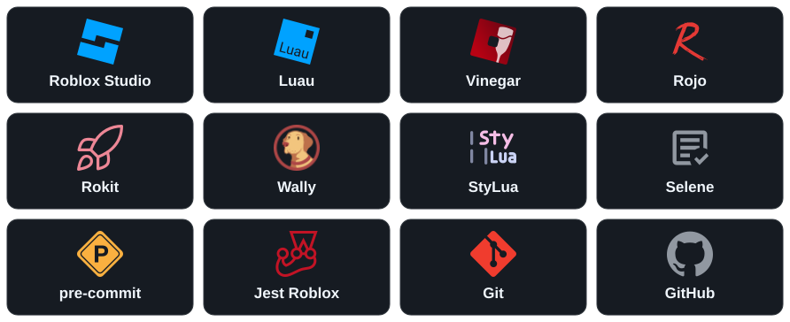

<h1 align="center">🧪 roblox-with-swe</h1>

<br>

<h3 align="center">A Roblox game built like a software project.<br>Code, tests, collaboration, and releases—explored on Linux</h3>

<p align="center">
  
</p>

<br>

## About

> **TL;DR:** a proof of concept for bringing software engineering to Roblox on Linux: source-controlled places, linting, automated regression tests, GitHub Flow, playtest previews, and eventually staging and production releases. Friends will build together through branches and reviewed pull requests, using Discord to discuss ideas and ask an agent to help implement them. That agent will be a new Hermes profile in my personal agent pepper, running in my homelab and contributing through the same tests and review process. This game is the first place to try that shared workflow.

## Contents

- [Technologies](#technologies)
- [How it works](#how-it-works)
- [Software engineering in Roblox](#software-engineering-in-roblox)
- [Work on the project](#work-on-the-project)
- [Roadmap](#roadmap)
- [Repository layout](#repository-layout)
- [Related projects](#related-projects)
- [References](#references)

## Technologies

<picture>
  <source media="(max-width: 640px)" srcset="assets/technologies-mobile.svg" />
  
</picture>

## How it works

<p align="center">
  
</p>

The solid paths work today: edit files, format and lint Luau, use Rojo to build or sync the place, and playtest in Roblox Studio through Vinegar. The dashed paths are the next experiments: contributions from friends and a Hermes profile, reviewed pull requests, regression tests, CI, and releases. The [editable Excalidraw source](assets/how-it-works.excalidraw) lives beside the image.

## Software engineering in Roblox

| Practice | Tool | What it means here |
|---|---|---|
| Source of truth | Git, Luau, Rojo project files, and model JSON | Scripts and the parts of the world we can describe as data live in files that can be reviewed and changed together. |
| Reproducible toolchain | Rokit | The repository pins the versions of Rojo, Wally, StyLua, and Selene. |
| Dependency management | Wally | `wally.toml` declares packages; `wally.lock` records the resolved versions. Jest Roblox is already installed as a development dependency. |
| Formatting | StyLua and pre-commit | Luau gets a consistent style before it enters Git. |
| Static analysis | Selene | Linting catches suspicious Luau code without launching the game. |
| Regression testing | Jest Roblox | Tests will exercise behavior in a Roblox environment so later changes cannot silently break it. The runner and first test are still to come. |
| Local integration | Rojo, Roblox Studio, and Vinegar | Rojo turns files into a place or syncs changes into Studio; Studio lets us see and play what we built on Linux. |
| Collaboration | GitHub Flow | Branches and pull requests will make changes visible to the group before they are merged. |
| Continuous integration and delivery | GitHub Actions and Roblox Open Cloud | Planned checks will validate changes, run suitable engine tests, and publish separate staging and production places. |
| AI collaboration | A Hermes profile in pepper | Planned Discord access will let friends work with an agent that contributes through the same repository and review process. |

The tools have different jobs. Rojo moves files into Roblox's DataModel; it does not decide whether the code is correct. Selene checks code without running it; Jest will check behavior by running it. A successful build is therefore only one part of a trustworthy change.

## Work on the project

### Requirements

- [Git](https://git-scm.com/install/) to clone and contribute to the repository.
- [GNU Make](https://www.gnu.org/software/make/#download) to run the project commands.
- [Rokit](https://github.com/rojo-rbx/rokit#installation) to install the pinned Rojo, Wally, StyLua, and Selene versions.
- [pre-commit](https://pre-commit.com/#installation) to enable the formatting hook.
- [Roblox Studio](https://create.roblox.com/docs/tutorials/curriculums/studio/install-studio), or [Vinegar](https://vinegarhq.org/Vinegar/Installation.html) to run Studio on Linux.
- [Rojo Studio plugin](https://create.roblox.com/store/asset/13916111004) for live syncing with Studio.

### Installation

From the repository root:

```bash
# Install the tool versions pinned in rokit.toml.
rokit install

# Install the dependencies declared in wally.toml.
wally install

# Enable automatic Luau formatting when committing.
pre-commit install
```

### Coding

```bash
# Edit the files in src/ and save your changes.

# Format Luau source files.
make format-apply

# Check Luau source files with Selene.
make lint

# Sync changes to Studio through the Rojo plugin.
make serve
```

### Building

```bash
# Build the development place in dist/.
make build

# Build the staging place file in dist/.
make build-staging

# Build the production place file in dist/.
make build-production
```

To view the place in Roblox Studio, open a built `.rbxlx` file or run `make serve` and connect the Rojo Studio plugin to its server URL.

## Roadmap

What is working now:

- ✅ Pin the local toolchain with Rokit.
- ✅ Build a place from source files and sync it into Studio with Rojo.
- ✅ Run Roblox Studio through Vinegar on Linux.
- ✅ Describe a small piece of the world as a Rojo model JSON file.
- ✅ Format Luau with StyLua and run it from pre-commit.
- ✅ Lint Luau with Selene.
- ✅ Add Wally and lock Jest Roblox as a development dependency.

What comes next:

- ❌ Add a small gameplay behavior worth testing.
- ❌ Set up a Rojo test place and run regression tests with Jest.
- ❌ Add Luau LSP for editor feedback and type-aware code navigation.
- ❌ Run formatting, linting, builds, and tests in GitHub Actions.
- ❌ Try Open Cloud Luau Execution for engine tests in CI.
- ❌ Publish separate staging and production places through the Roblox API.
- ❌ Try scripted Studio playtests, including whether Vinegar can run them unattended on Linux.
- ❌ Establish GitHub Flow with friends and document contribution rules.
- ❌ Add a Hermes profile in pepper that opens PRs from Discord.

## Repository layout

```sh
.
├── assets/
│   ├── how-it-works.excalidraw  # editable workflow diagram
│   └── how-it-works.svg         # diagram shown above
│
├── src/
│   ├── client/                  # client-side Luau
│   ├── server/                  # server-side Luau
│   ├── shared/                  # shared modules
│   └── world/                   # world objects for Rojo
│
├── default.project.json         # files mapped into the Roblox DataModel
├── Makefile                     # local development commands
│
├── rokit.toml                   # pinned development tools
├── wally.toml                   # package declarations
├── wally.lock                   # resolved package versions
│
├── .stylua.toml                 # formatter configuration
├── selene.toml                  # linter configuration
└── .pre-commit-config.yaml      # formatting hook
```

## License

This repository is licensed under the [MIT License](LICENSE).

## Related projects

- [pepper](https://github.com/Petri-Hub/pepper): my personal agent; the planned Hermes profile for this project will be documented there.
- [lab](https://github.com/Petri-Hub/lab): my homelab, where pepper and the new profile will run.

## References

- [Roblox Creator Hub](https://create.roblox.com/docs): engine, Studio, and publishing documentation
- [Rojo](https://rojo.space/docs/): file-to-DataModel mapping, building, and live sync
- [Rokit](https://github.com/rojo-rbx/rokit): versioned development tools
- [Wally](https://github.com/UpliftGames/wally): packages, manifest, and lockfile
- [StyLua](https://github.com/JohnnyMorganz/StyLua): Luau formatting
- [pre-commit](https://pre-commit.com/): Git hook setup and configuration
- [Selene](https://kampfkarren.github.io/selene/): Luau linting
- [Jest Roblox](https://roblox.github.io/jest-roblox/): test runner and assertions
- [Luau LSP](https://github.com/JohnnyMorganz/luau-lsp): editor analysis and Rojo sourcemaps
- [Vinegar](https://vinegarhq.org/): Roblox Studio on Linux
- [Studio testing modes](https://create.roblox.com/docs/studio/testing-modes): playtests and scripted tests
- [Open Cloud Luau Execution](https://create.roblox.com/docs/cloud/reference/features/luau-execution): engine code execution for automation
- [Place publishing API](https://create.roblox.com/docs/cloud/guides/usage-place-publishing): automated place releases
- [Git](https://git-scm.com/doc): version control for the project
- [GitHub Flow](https://docs.github.com/en/get-started/using-github/github-flow): branch and pull request collaboration
- [GitHub Actions](https://docs.github.com/en/actions): CI and deployment workflows
- [Wakapi](https://wakapi.dev): time tracking for this project and the badge above
