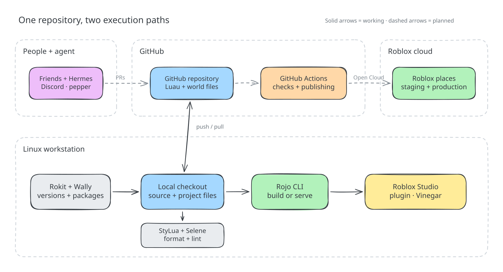
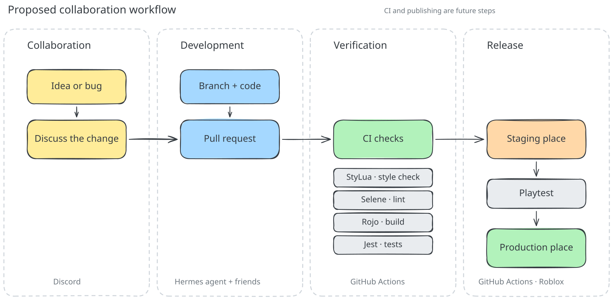

<h1 align="center">🧪 roblox-with-swe</h1>

<br>

<h3 align="center">A Roblox game built like a software project.<br>Code, tests, collaboration, and releases—explored on Linux</h3>

<p align="center">
  <a href="https://github.com/Petri-Hub/roblox-with-swe/actions/workflows/publish.yml"></a>
  <a href="LICENSE"></a>
  
</p>

<br>

## About

> **TL;DR:** a proof of concept for bringing software engineering to Roblox on Linux: source-controlled places, linting, automated regression tests, Git Flow, playtest previews, and eventually staging and production releases. Friends will build together through branches and reviewed pull requests, using Discord to discuss ideas and ask an agent to help implement them. That agent will be a new Hermes profile in my personal agent pepper, running in my homelab and contributing through the same tests and review process. This game is the first place to try that shared workflow.

## Play the game

This AI-assisted horror game is taking shape in a procedurally generated forest, planted with twelve realistic Creator Store ponderosa pines (`src/assets/trees/PonderosaPines.rbxm`) at random heights and rotations on top of the generated terrain. The current build is an early playtest of the map, first-person movement, and the first weapon.

Every life starts with the flashlight and the `M9` pistol — kills are the shop currency, so you need a gun to earn the first ones — and the rest is bought with ghost kills at a shop the forest generates for you. The AK-47 (30 rounds, 600 rounds per minute, iron sights while holding right mouse, `R` to reload) costs 4 kills, the `M9` pistol — semi automatic, 15 rounds — costs 2 kills, and the UV floodlight costs 6. Until you pay, that slot is empty — it keeps only its number, with no item name — and refuses to equip it. Both guns run on the same engine and differ only in their definition file. The flashlight lives in the hotbar: press `2` to take it out or put it away, and `F` to turn its beam on or off. Press the slot that is in hand again, or `0`, to walk with empty hands. Casting a spell puts the item away too, because the fireball and the telekinesis need the hand. Slot `3` is the ghost detector, which reads the distance to the nearest ghost in studs every three seconds. Slot `4` is the UV floodlight: hold left mouse to wash ghosts in violet light, which burns them slowly and pushes them back, until the 8 second battery runs dry; it refills on its own in 10 seconds. The handheld flashlight runs a wide 110-degree flood cone, so it lights a clearing instead of a pencil beam. Ghosts drift out of the fog at 4.4 studs per second groaning, and every one you put down adds a point to the `KILLS` counter in the corner. They come in two shipped looks (`src/assets/Ghost.rbxm` and `src/assets/GhostAlt2.rbxm`, Creator Store assets `16371325697` and `14659873441`) with a random tint and height, all scaled to about seven studs.

### The shop

`ShopService` plants one stall in the forest, built from parts at a point taken from the forest seed (`ShopLayout.pointFor`), 96 to 132 studs out and never on the spawn sightline. Before it builds, it levels a flat pad in the terrain so a slope cannot swallow the floor, clears the trees standing where the counter goes, hangs two warm lamps and a sign, and drops a `Sound` (`1839910323`, a 30 second music box) on a linear rolloff so the track is at full volume only at the counter and gone past 78 studs: you hear the shop before you see it, but not from across the map.

The game is first person, and first person locks the cursor to the centre, so `ShopClient` steps the camera back and frees the mouse while you stand at the counter; walk away and the first-person camera comes back.

Prices live in `src/shared/ShopCatalog.luau` and the money is the `KILLS` counter. The client only asks to buy; `ShopService` checks the distance to the counter, the price, whether you already own the item, then spends the kills, flips the ownership attribute and puts the purchase in your hands. Combat and the UV lamp check ownership on every use, so an unpaid client cannot shoot the rifle it did not buy.

### The fire magic

The fireball is everyone's spell for now, not a shop item. Press `Z` and the character points the right arm and hand at the cursor; a spinning rune circle, built from neon parts and fire particles, opens in front of the palm and a fireball leaves it. The ball flies at 110 studs per second up to 240 studs with a particle trail and its own light.

Hold `Z` to charge it: the circle in front of the palm grows with the hold, and so does the ball, up to a ceiling of 1.6 seconds and 2.2 times its size. Let go to throw. A tap still throws the small ball.

On impact it explodes: a flash, an expanding shockwave, fire, sparks, smoke, embers, a boom and a light tremor on the screens of players within 55 studs. A direct hit deals 120 damage — enough to kill a full-health ghost — and the blast splashes up to 100 damage within 16 studs. A fully charged ball is bigger and meaner: 240 direct damage, 190 splash at the centre, and a 26-stud radius, with the crater, the cracks and the blast particles scaled to match. The surface under the blast gets a scorched crater and eight to eleven radial cracks that follow the terrain and disappear after 30 seconds. Each cast is followed by `SOL CRUEL` above the character and in the chat, and the spell takes 6 seconds to recharge; the badge above the UV battery shows the countdown.

The tuning lives in `src/shared/FireMagic.luau`, the damage, projectile and scorch marks in `src/server/FireMagicService.luau`, the input, first-person arm and cooldown badge in `src/client/FireMagicController.client.luau`, and the circle, ball, blast and screen shake in `src/client/FireMagicEffects.client.luau`.

### The telekinesis

The second spell, also free. Point the cursor at a prop or a ghost and press `X`: it leaves the ground and floats where you point. It chases the cursor at 60 studs per second, never further than 45 studs from you, with a white rune circle behind it — the fireball's circle in white, but with an eight-pointed star of two squares instead of the double triangle — three rings of white wind blades, a swirl of wind particles and a looping gust. `X` again lowers it: a prop settles back on the ground, a ghost drifts down. Press right mouse while it floats to hurl it.

Only props of a sane size answer the spell: the largest side of the bounding box up to 14 studs and at most 80 parts. Barrels, crates, logs, stumps and bushes fly. Trees are the exception — a whole forest pine up to 72 studs tall and 60 parts is under the spell's control, so the trunk and canopy lift together as one piece. The cabin, the shop stall, the spawn pad and the terrain stay where they are. A ghost is grabbed whole: its chase AI is suspended and the server drives its pivot while the spell holds it. One object can only be under one spell at a time.

A throw flies at 120 studs per second for up to 120 studs and stops on the first surface or ghost it meets. The hit deals 70 damage and splashes up to 45 more within 9 studs; a thrown ghost takes the same hit, hangs dazed for 2 seconds afterwards, and a heavy prop that lands on a ghost counts as a direct hit. The impact raises dust, wind sparks, a white shockwave, a thud and a small screen tremor, and the throw itself plays the ascending gust. The spell recharges in 2.5 seconds after the object leaves your hand; the small badge above the fireball badge shows the countdown.

The two spells do not overlap. While something floats, the gun is put away, right mouse throws instead of aiming and `Z` waits. Casting either spell also empties the hand: the item returns to the hotbar, and the player picks it again if wanted.

The tuning lives in `src/shared/Telekinesis.luau`, the grab, drag, throw and damage in `src/server/TelekinesisService.luau`, the input, first-person arm and badge in `src/client/TelekinesisController.client.luau`, the white circle in `src/client/MagicCircle.luau`, and the wind, impacts and shake in `src/client/TelekinesisEffects.client.luau`.

### The arena

`ArenaService` builds a coliseum at `Arena.ORIGIN` — 1600, 180, 0 — far above and away from the forest, so the procedural map never collides with it. The sand is 52 studs across, ringed by a wall with four iron gates, four tiers of stone seats, an outer wall with merlons, eight columns, red banners, eight burning torches and a gold `ARENA` plaque over the entrance. It is built from parts at server start, the same way the shop stall is.

Two chat commands move a player between the places. `/arena` (or `/coliseu`) teleports to the spawn facing the sand; `/floresta` (or `/sair`) returns to `ForestSpawn`. They are `TextChatCommand`s created under `TextChatService`, so the command is intercepted and never broadcast; a `Player.Chatted` fallback covers the old chat path, and a debounce makes sure a client that reports both paths only teleports once. The move itself is a server-side `PivotTo` of the character.

The arena has no enemies of its own yet: the ghost spawner places ghosts around players inside the forest and culls the ones too far from every player, so the forest empties while everyone is away.

### Adding a weapon

Weapons are data. `WeaponSpec` owns the magazine, cadence, reload, spread, recoil and state sync for every gun, and `WeaponRegistry` hands out the validated definitions. To add one:

1. Copy `src/shared/weapons/M9.luau` to `src/shared/weapons/<Gun>.luau` and change the numbers: `id`, `name`, `fireMode` (`auto` or `semi`), `damage`, `roundsPerMinute`, `magazine`, `startingReserve`, `maxReserve`, `reloadTime`, `range`, the three spreads, the recoil pairs, `sounds`, and the `viewmodel` part list (including `muzzlePart`, `boltPart` and `magazinePart`).
2. Register it once in `src/shared/WeaponRegistry.luau`.
3. Add it to the hotbar in `src/shared/Inventory.luau` — the label and the hint come from the definition.

`WeaponSpec.derive` validates the table and fails the build on a missing name, a zero cadence, a part named twice, a muzzle that is not in the part list or a gun without a fire sound, so a typo cannot ship a weapon that does not shoot. Three tests in `tests/specs/WeaponSpec.spec.luau` run a synthetic third gun through the same engine to keep the abstraction honest.

- [Staging playtest](https://www.roblox.com/games/112768229129661) receives changes merged into `staging`.
- [Production game](https://www.roblox.com/games/138015860615681) receives changes merged into `production`.

## Contents

- [Play the game](#play-the-game)
- [How it works](#how-it-works)
- [Software engineering in Roblox](#software-engineering-in-roblox)
- [Collaboration](#collaboration)
- [Technologies](#technologies)
- [Work on the project](#work-on-the-project)
- [Roadmap](#roadmap)
- [Repository layout](#repository-layout)
- [Related projects](#related-projects)
- [References](#references)

## How it works

<p align="center">
  
</p>

The GitHub repository holds the Luau and world files. On Linux, a local checkout uses Rokit and Wally for tools and dependencies, StyLua and Selene for source checks, and Rojo to build a place or sync it to Studio through Vinegar. The planned path connects friends and the Hermes profile in pepper through pull requests; GitHub Actions runs checks and publishes staging and production places through Roblox Open Cloud.

## Software engineering in Roblox

| Practice | Tool | What it means here |
|---|---|---|
| Source of truth | Git, Luau, Rojo project files, and model JSON | Scripts and the parts of the world we can describe as data live in files that can be reviewed and changed together. |
| Reproducible toolchain | Rokit | The repository pins the versions of Rojo, Wally, StyLua, Selene, and jest-roblox-cli. |
| Dependency management | Wally | `wally.toml` declares packages; `wally.lock` records the resolved versions. Jest Roblox is already installed as a development dependency. |
| Formatting | StyLua and pre-commit | Luau gets a consistent style before it enters Git. |
| Static analysis | Selene | Linting catches suspicious Luau code without launching the game. |
| Regression testing | Jest Roblox and jest-roblox-cli | A separate test place runs the tree harvesting rules, locally through Studio on Linux or remotely through Roblox Open Cloud. |
| Continuous integration and delivery | GitHub Actions and Roblox Open Cloud | Pull requests run formatting, linting, builds, and engine tests; merges publish separate staging and production places. |

The tools have different jobs. Rojo moves files into Roblox's DataModel; it does not decide whether the code is correct. Selene checks code without running it; Jest checks behavior by running it. A successful build is therefore only one part of a trustworthy change.

The first feature lets a player harvest the tree in the world. The server checks the player's distance and the tree's regrowth timer, awards one wood, then hides the canopy for eight seconds. A client HUD shows the wood count. The harvest rules live in a shared module so they can be tested without waiting for a real timer.

## Collaboration

<p align="center">
  
</p>

Friends start with an idea or bug in Discord. A contributor or Lemon, the Hermes agent in pepper, turns the agreed change into code on a branch and opens a pull request. GitHub Actions checks formatting with StyLua, lint with Selene, build with Rojo, and run Jest tests. Passing changes reach a staging place for playtesting before a production release.

The project keeps its development skills in `.agents/skills/`, covering setup, previews, design, implementation, tests, documentation and delivery.

## Technologies

<table align="center">
  <tr>
    <td align="center" width="112"><a href="https://create.roblox.com/docs/studio"><br>Roblox Studio</a></td>
    <td align="center" width="112"><a href="https://luau.org/"><br>Luau</a></td>
    <td align="center" width="112"><a href="https://vinegarhq.org/Vinegar/Installation.html"><br>Vinegar</a></td>
    <td align="center" width="112"><a href="https://rojo.space/docs/v7/"><br>Rojo</a></td>
    <td align="center" width="112"><a href="https://github.com/rojo-rbx/rokit"><br>Rokit</a></td>
    <td align="center" width="112"><a href="https://wally.run/"><br>Wally</a></td>
  </tr>
  <tr>
    <td align="center" width="112"><a href="https://github.com/JohnnyMorganz/StyLua"><br>StyLua</a></td>
    <td align="center" width="112"><a href="https://kampfkarren.github.io/selene/"><br>Selene</a></td>
    <td align="center" width="112"><a href="https://pre-commit.com/"><br>pre-commit</a></td>
    <td align="center" width="112"><a href="https://roblox.github.io/jest-roblox/"><br>Jest Roblox</a></td>
    <td align="center" width="112"><a href="https://git-scm.com/docs"><br>Git</a></td>
    <td align="center" width="112"><a href="https://docs.github.com/"><br>GitHub</a></td>
  </tr>
</table>

## Work on the project

### Requirements

- [Git](https://git-scm.com/install/) to clone and contribute to the repository.
- [GNU Make](https://www.gnu.org/software/make/#download) to run the project commands.
- [Rokit](https://github.com/rojo-rbx/rokit#installation) to install the pinned development tools.
- [curl](https://curl.se/download.html) to install the Jest Studio plugin on Linux.
- [pre-commit](https://pre-commit.com/#installation) to enable the formatting hook.
- [Roblox Studio](https://create.roblox.com/docs/tutorials/curriculums/studio/install-studio), or [Vinegar](https://vinegarhq.org/Vinegar/Installation.html) to run Studio on Linux.
- [Rojo Studio plugin](https://create.roblox.com/store/asset/13916111004) for live syncing with Studio.

### Installation

From the repository root:

```bash
# Install the tool versions pinned in rokit.toml.
rokit install

# Install the dependencies declared in wally.toml.
wally install

# Enable automatic Luau formatting when committing.
pre-commit install

# On Linux, install the matching Jest plugin in Vinegar's Studio.
bash scripts/install-jest-plugin.sh
```

### Coding

```bash
# Edit the files in src/ and save your changes.

# Format Luau source files.
make format-apply

# Check Luau source files with Selene.
make lint

# Sync changes to Studio through the Rojo plugin.
make serve
```

### Building

```bash
# Build the development place in dist/.
make build

# Build the staging place file in dist/.
make build-staging

# Build the production place file in dist/.
make build-production
```

To view the place in Roblox Studio, open a built `.rbxlx` file or run `make serve` and connect the Rojo Studio plugin to its server URL.

### Testing

```bash
# Run the Jest regression tests through Vinegar.
make test-on-system

# Run the same tests in Roblox Open Cloud, without Studio.
make test-on-ocale
```

`make test-on-system` builds the test place from the current working files, launches Studio through Vinegar, runs Jest, prints the result, and closes Studio. The test place includes Wally's development packages, so run `wally install` first. Studio opens a window during the run.

## Roadmap

What is working now:

- ✅ Pin the local toolchain with Rokit.
- ✅ Build a place from source files and sync it into Studio with Rojo.
- ✅ Run Roblox Studio through Vinegar on Linux.
- ✅ Describe a small piece of the world as a Rojo model JSON file.
- ✅ Format Luau with StyLua and run it from pre-commit.
- ✅ Lint Luau with Selene.
- ✅ Add Wally and lock Jest Roblox as a development dependency.
- ✅ Add a small tree harvesting behavior worth testing.
- ✅ Build a separate Rojo test place with Jest tests for the harvesting rules.
- ✅ Run Jest from a Linux terminal with jest-roblox-cli and Vinegar.
- ✅ Run Jest through Open Cloud with a dedicated test place.
- ✅ Run formatting, linting, builds, and engine tests in GitHub Actions.
- ✅ Publish separate staging and production places through the Roblox API.
- ✅ Build roblox-assets-mcp for Creator Store search and download URLs.

## Repository layout

```sh
.
├── .agents/skills/              # project-specific agent workflows
│
├── .github/
│   └── workflows/
│       ├── quality.yml          # format, lint, build, and Jest checks
│       └── publish.yml          # build and publish staging and production places
│
├── assets/
│   ├── collaboration.excalidraw  # editable collaboration diagram
│   ├── collaboration.svg         # collaboration diagram shown above
│   ├── how-it-works.excalidraw  # editable workflow diagram
│   └── how-it-works.svg         # workflow diagram shown above
│
├── src/
│   ├── client/                  # client-side Luau
│   ├── server/                  # server-side Luau
│   ├── shared/                  # shared modules
│   └── world/                   # world objects for Rojo
│
├── tests/                       # Jest regression specs
├── scripts/                     # Vinegar launch and plugin setup scripts
│
├── default.project.json         # files mapped into the Roblox DataModel
├── test.project.json            # separate place for running Jest tests
├── jest.config.toml             # Jest CLI configuration
├── Makefile                     # local development commands
│
├── rokit.toml                   # pinned development tools
├── wally.toml                   # package declarations
├── wally.lock                   # resolved package versions
│
├── .stylua.toml                 # formatter configuration
├── selene.toml                  # linter configuration
└── .pre-commit-config.yaml      # formatting hook
```

## License

This repository is licensed under the [MIT License](LICENSE).

## Related projects

| 📦<br>[roblox-assets-mcp](https://github.com/Petri-Hub/roblox-assets-mcp) | 🐦<br>[pepper](https://github.com/Petri-Hub/pepper) | 🧰<br>[lab](https://github.com/Petri-Hub/lab) |
|---|---|---|
| Asset-only MCP server for Creator Store search, previews, and temporary download URLs. | My personal agent; the planned Hermes profile for this project will be documented there. | My homelab, where pepper and the new profile will run. |

## References

- [Roblox Creator Hub](https://create.roblox.com/docs): engine, Studio, and publishing documentation
- [Rojo](https://rojo.space/docs/): file-to-DataModel mapping, building, and live sync
- [Rokit](https://github.com/rojo-rbx/rokit): versioned development tools
- [Wally](https://github.com/UpliftGames/wally): packages, manifest, and lockfile
- [StyLua](https://github.com/JohnnyMorganz/StyLua): Luau formatting
- [pre-commit](https://pre-commit.com/): Git hook setup and configuration
- [Selene](https://kampfkarren.github.io/selene/): Luau linting
- [Jest Roblox](https://roblox.github.io/jest-roblox/): test runner and assertions
- [jest-roblox-cli](https://github.com/christopher-buss/jest-roblox-cli): terminal runner for Studio and Open Cloud
- [Luau LSP](https://github.com/JohnnyMorganz/luau-lsp): editor analysis and Rojo sourcemaps
- [Vinegar](https://vinegarhq.org/): Roblox Studio on Linux
- [Studio testing modes](https://create.roblox.com/docs/studio/testing-modes): playtests and scripted tests
- [Studio command-line interface](https://create.roblox.com/docs/studio/command-line-interface): run a Luau test entrypoint from a terminal
- [Open Cloud API keys](https://create.roblox.com/docs/cloud/auth/api-keys): key creation, permissions, and expiration
- [Open Cloud scopes](https://create.roblox.com/docs/cloud/reference/scopes): the permission each endpoint requires
- [Open Cloud Luau Execution](https://create.roblox.com/docs/cloud/reference/features/luau-execution): engine code execution for automation
- [Place publishing API](https://create.roblox.com/docs/cloud/guides/usage-place-publishing): automated place releases
- [Git](https://git-scm.com/doc): version control for the project
- [Git Flow](https://nvie.com/posts/a-successful-git-branching-model/): feature, release, and hotfix branches
- [GitHub Actions](https://docs.github.com/en/actions): CI and deployment workflows
- [Wakapi](https://wakapi.dev): time tracking for this project and the badge above
