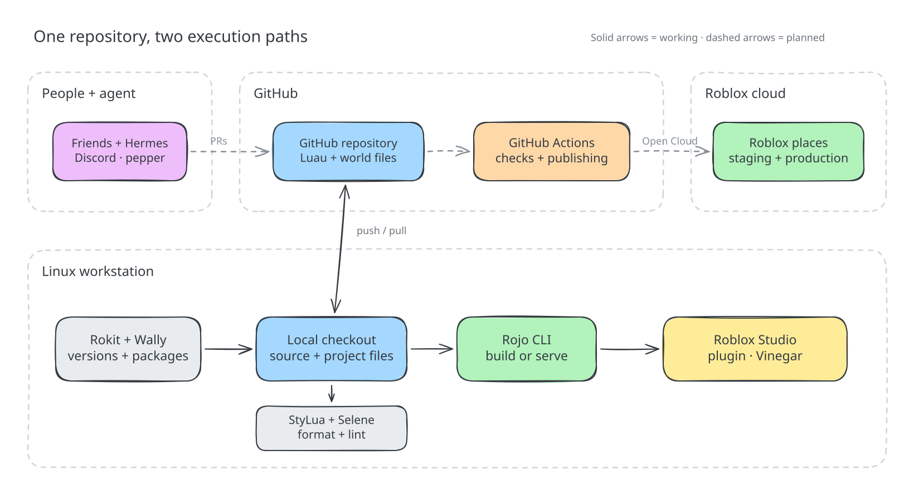
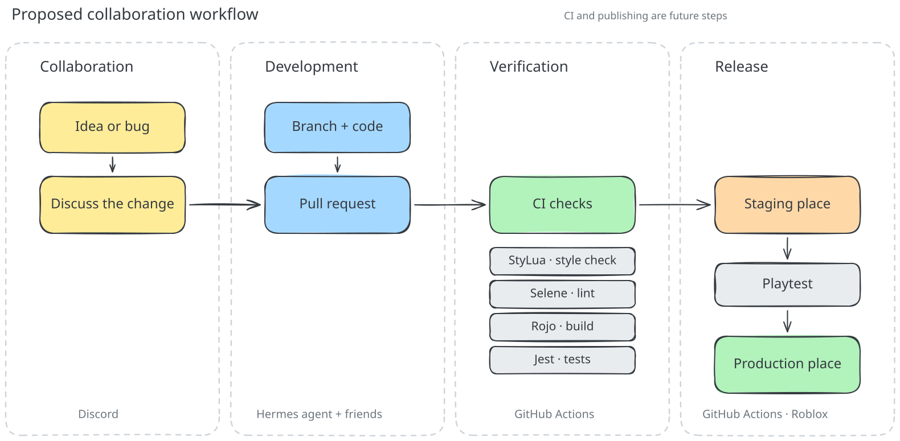

<h1 align="center">🧪 roblox-with-swe</h1>

<br>

<h3 align="center">A Roblox game built like a software project.<br>Code, tests, collaboration, and releases—explored on Linux</h3>

<p align="center">
  
</p>

<br>

## About

> **TL;DR:** a proof of concept for bringing software engineering to Roblox on Linux: source-controlled places, linting, automated regression tests, Git Flow, playtest previews, and eventually staging and production releases. Friends will build together through branches and reviewed pull requests, using Discord to discuss ideas and ask an agent to help implement them. That agent will be a new Hermes profile in my personal agent pepper, running in my homelab and contributing through the same tests and review process. This game is the first place to try that shared workflow.

## Contents

- [How it works](#how-it-works)
- [Software engineering in Roblox](#software-engineering-in-roblox)
- [Collaboration](#collaboration)
- [Technologies](#technologies)
- [Work on the project](#work-on-the-project)
- [Roadmap](#roadmap)
- [Repository layout](#repository-layout)
- [Related projects](#related-projects)
- [References](#references)

## How it works

<p align="center">
  
</p>

The GitHub repository holds the Luau and world files. On Linux, a local checkout uses Rokit and Wally for tools and dependencies, StyLua and Selene for source checks, and Rojo to build a place or sync it to Studio through Vinegar. The planned path connects friends and the Hermes profile in pepper through pull requests; GitHub Actions would run checks and publish staging and production places through Roblox Open Cloud.

## Software engineering in Roblox

| Practice | Tool | What it means here |
|---|---|---|
| Source of truth | Git, Luau, Rojo project files, and model JSON | Scripts and the parts of the world we can describe as data live in files that can be reviewed and changed together. |
| Reproducible toolchain | Rokit | The repository pins the versions of Rojo, Wally, StyLua, and Selene. |
| Dependency management | Wally | `wally.toml` declares packages; `wally.lock` records the resolved versions. Jest Roblox is already installed as a development dependency. |
| Formatting | StyLua and pre-commit | Luau gets a consistent style before it enters Git. |
| Static analysis | Selene | Linting catches suspicious Luau code without launching the game. |
| Regression testing | Jest Roblox | A separate test place runs the tree harvesting rules through Studio's command line mode on Linux. |
| Continuous integration and delivery | GitHub Actions and Roblox Open Cloud | Planned checks will validate changes, run suitable engine tests, and publish separate staging and production places. |

The tools have different jobs. Rojo moves files into Roblox's DataModel; it does not decide whether the code is correct. Selene checks code without running it; Jest checks behavior by running it. A successful build is therefore only one part of a trustworthy change.

The first feature lets a player harvest the tree in the world. The server checks the player's distance and the tree's regrowth timer, awards one wood, then hides the canopy for eight seconds. A client HUD shows the wood count. The harvest rules live in a shared module so they can be tested without waiting for a real timer.

## Collaboration

<p align="center">
  
</p>

Friends start with an idea or bug in Discord. A contributor or the planned Hermes profile in pepper turns the agreed change into code on a branch and opens a pull request. GitHub Actions would then check formatting with StyLua, lint with Selene, build with Rojo, and run Jest tests. Passing changes would reach a staging place for playtesting before a production release.

## Technologies

<table align="center">
  <tr>
    <td align="center" width="112"><a href="https://create.roblox.com/docs/studio"><br>Roblox Studio</a></td>
    <td align="center" width="112"><a href="https://luau.org/"><br>Luau</a></td>
    <td align="center" width="112"><a href="https://vinegarhq.org/Vinegar/Installation.html"><br>Vinegar</a></td>
    <td align="center" width="112"><a href="https://rojo.space/docs/v7/"><br>Rojo</a></td>
    <td align="center" width="112"><a href="https://github.com/rojo-rbx/rokit"><br>Rokit</a></td>
    <td align="center" width="112"><a href="https://wally.run/"><br>Wally</a></td>
  </tr>
  <tr>
    <td align="center" width="112"><a href="https://github.com/JohnnyMorganz/StyLua"><br>StyLua</a></td>
    <td align="center" width="112"><a href="https://kampfkarren.github.io/selene/"><br>Selene</a></td>
    <td align="center" width="112"><a href="https://pre-commit.com/"><br>pre-commit</a></td>
    <td align="center" width="112"><a href="https://roblox.github.io/jest-roblox/"><br>Jest Roblox</a></td>
    <td align="center" width="112"><a href="https://git-scm.com/docs"><br>Git</a></td>
    <td align="center" width="112"><a href="https://docs.github.com/"><br>GitHub</a></td>
  </tr>
</table>

## Work on the project

### Requirements

- [Git](https://git-scm.com/install/) to clone and contribute to the repository.
- [GNU Make](https://www.gnu.org/software/make/#download) to run the project commands.
- [Rokit](https://github.com/rojo-rbx/rokit#installation) to install the pinned Rojo, Wally, StyLua, and Selene versions.
- [pre-commit](https://pre-commit.com/#installation) to enable the formatting hook.
- [Roblox Studio](https://create.roblox.com/docs/tutorials/curriculums/studio/install-studio), or [Vinegar](https://vinegarhq.org/Vinegar/Installation.html) to run Studio on Linux. The terminal test command uses Vinegar's Flatpak package.
- [Rojo Studio plugin](https://create.roblox.com/store/asset/13916111004) for live syncing with Studio.

### Installation

From the repository root:

```bash
# Install the tool versions pinned in rokit.toml.
rokit install

# Install the dependencies declared in wally.toml.
wally install

# Enable automatic Luau formatting when committing.
pre-commit install
```

### Coding

```bash
# Edit the files in src/ and save your changes.

# Format Luau source files.
make format-apply

# Check Luau source files with Selene.
make lint

# Sync changes to Studio through the Rojo plugin.
make serve
```

### Building

```bash
# Build the development place in dist/.
make build

# Build the staging place file in dist/.
make build-staging

# Build the production place file in dist/.
make build-production

# Build the separate Jest test place in dist/.
make build-tests

# Build the test place and run Jest from the terminal through Vinegar.
make test
```

To view the place in Roblox Studio, open a built `.rbxlx` file or run `make serve` and connect the Rojo Studio plugin to its server URL.

`make test` launches Studio through Vinegar, runs Jest, prints the result, and closes Studio. Close other Studio windows before running it. The test place includes the Wally development packages, so run `wally install` before building it. You can also open `dist/tests.rbxlx` in Studio, press Play, and check the Output window.

## Roadmap

What is working now:

- ✅ Pin the local toolchain with Rokit.
- ✅ Build a place from source files and sync it into Studio with Rojo.
- ✅ Run Roblox Studio through Vinegar on Linux.
- ✅ Describe a small piece of the world as a Rojo model JSON file.
- ✅ Format Luau with StyLua and run it from pre-commit.
- ✅ Lint Luau with Selene.
- ✅ Add Wally and lock Jest Roblox as a development dependency.
- ✅ Add a small tree harvesting behavior worth testing.
- ✅ Build a separate Rojo test place with Jest tests for the harvesting rules.
- ✅ Run Jest from a Linux terminal through Vinegar and Studio's command line mode.

What comes next:

- ❌ Add Luau LSP for editor feedback and type-aware code navigation.
- ❌ Run formatting, linting, builds, and engine tests in GitHub Actions.
- ❌ Try Open Cloud Luau Execution for engine tests in CI.
- ❌ Publish separate staging and production places through the Roblox API.
- ❌ Try scripted Studio playtests, including whether Vinegar can run them unattended on Linux.
- ❌ Establish Git Flow with friends and document contribution rules.
- ❌ Add a Hermes profile in pepper that opens PRs from Discord.

## Repository layout

```sh
.
├── assets/
│   ├── collaboration.excalidraw  # editable collaboration diagram
│   ├── collaboration.svg         # collaboration diagram shown above
│   ├── how-it-works.excalidraw  # editable workflow diagram
│   └── how-it-works.svg         # workflow diagram shown above
│
├── src/
│   ├── client/                  # client-side Luau
│   ├── server/                  # server-side Luau
│   ├── shared/                  # shared modules
│   └── world/                   # world objects for Rojo
│
├── tests/                       # Jest tests and Studio test runner
├── scripts/                     # local test command
│
├── default.project.json         # files mapped into the Roblox DataModel
├── test.project.json            # separate place for running Jest tests
├── Makefile                     # local development commands
│
├── rokit.toml                   # pinned development tools
├── wally.toml                   # package declarations
├── wally.lock                   # resolved package versions
│
├── .stylua.toml                 # formatter configuration
├── selene.toml                  # linter configuration
└── .pre-commit-config.yaml      # formatting hook
```

## License

This repository is licensed under the [MIT License](LICENSE).

## Related projects

- [pepper](https://github.com/Petri-Hub/pepper): my personal agent; the planned Hermes profile for this project will be documented there.
- [lab](https://github.com/Petri-Hub/lab): my homelab, where pepper and the new profile will run.

## References

- [Roblox Creator Hub](https://create.roblox.com/docs): engine, Studio, and publishing documentation
- [Rojo](https://rojo.space/docs/): file-to-DataModel mapping, building, and live sync
- [Rokit](https://github.com/rojo-rbx/rokit): versioned development tools
- [Wally](https://github.com/UpliftGames/wally): packages, manifest, and lockfile
- [StyLua](https://github.com/JohnnyMorganz/StyLua): Luau formatting
- [pre-commit](https://pre-commit.com/): Git hook setup and configuration
- [Selene](https://kampfkarren.github.io/selene/): Luau linting
- [Jest Roblox](https://roblox.github.io/jest-roblox/): test runner and assertions
- [Luau LSP](https://github.com/JohnnyMorganz/luau-lsp): editor analysis and Rojo sourcemaps
- [Vinegar](https://vinegarhq.org/): Roblox Studio on Linux
- [Studio testing modes](https://create.roblox.com/docs/studio/testing-modes): playtests and scripted tests
- [Studio command-line interface](https://create.roblox.com/docs/studio/command-line-interface): run a Luau test entrypoint from a terminal
- [Open Cloud Luau Execution](https://create.roblox.com/docs/cloud/reference/features/luau-execution): engine code execution for automation
- [Place publishing API](https://create.roblox.com/docs/cloud/guides/usage-place-publishing): automated place releases
- [Git](https://git-scm.com/doc): version control for the project
- [Git Flow](https://nvie.com/posts/a-successful-git-branching-model/): feature, release, and hotfix branches
- [GitHub Actions](https://docs.github.com/en/actions): CI and deployment workflows
- [Wakapi](https://wakapi.dev): time tracking for this project and the badge above
