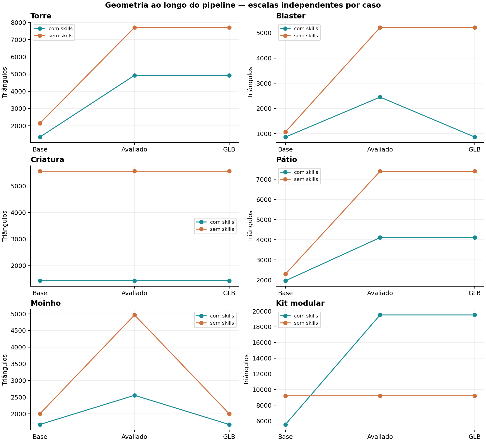
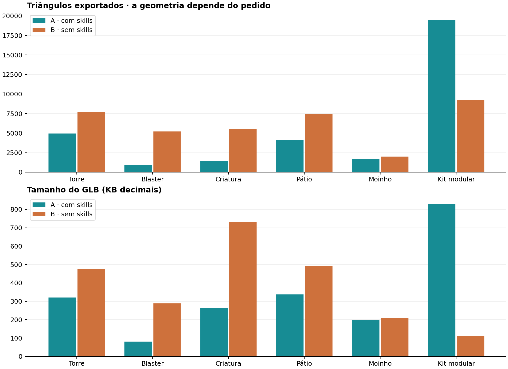
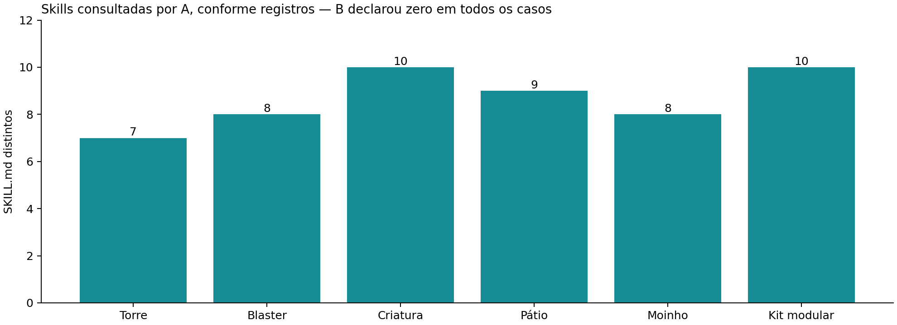

# Blender headless com Luna — síntese global

As skills não garantiram melhor qualidade geral em todos os pedidos. Na torre e no blaster, preferi a versão sem skills; na criatura, capela, moinho e kit modular, preferi a versão com skills, com vantagem visual pequena no moinho e pendências importantes no kit. Essas são preferências não cegas de um avaliador, não um placar estatístico.

O pacote disponibilizou procedimentos de organização, exportação e QA; a aplicação continuou sujeita a erros. No blaster, um pass=true se referia somente ao piso de estúdio. Na torre, um guarda-corpo bloqueava a escada apesar da revisão. No kit sem skills, arquivos válidos coexistem com obstáculos no corredor e na curva. Portanto, o resultado deve ser julgado pelo pedido e pelos dados efetivos, não pela quantidade de skills lidas ou pelo sinal de sucesso de uma ferramenta.

O fluxo headless é operacionalmente viável: bpy gerou modelos, os agentes produziram e inspecionaram renders e houve exportações estáticas e animadas importáveis. Isso demonstra capacidade do fluxo, mas não mede o benefício isolado da visão, pois os dois grupos tiveram acesso a imagens. Não há evidência de que uma dessas condições sempre seja melhor, nem medição real de tokens ou custo monetário.

## Resultados por categoria

### Torre

Nesta execução, a versão sem skills foi minha preferência visual e meu ponto de partida geral. A versão com skills usou menos geometria, gerou um arquivo menor e investiu mais em revisão técnica. As duas têm problemas de construção que impedem tratá-las como assets finais.

Minha recomendação é contextual: com prioridade artística eu continuaria B; com um orçamento geométrico mais restrito, A merece consideração. Não há vencedor universal demonstrado por este par. Os dois subagentes eram GPT-6 Luna, no mesmo nível de raciocínio.

[PDF](./report.pdf)

### Blaster

O blaster sem skills (B) foi minha preferência para o pedido, principalmente pela identidade arcana mais explícita, cristal visível e acabamento nos dois lados. A entrega com skills (A) é muito mais econômica e tem uma linguagem angular low poly consistente. A execução de QA em A não cobriu o objeto solicitado.

A diferença mais objetiva é a economia: A exportou 868 triângulos contra 5.216 de B. A diferença de qualidade depende do critério: B comunica melhor o cristal arcano e os detalhes próximos, enquanto A é útil para um orçamento muito baixo de geometria. A preferência não constitui prova geral contra skills.

[PDF](cases/01-arcane-blaster/report.pdf)

### Criatura

Neste par, a versão com skills (A) foi minha preferência: tem silhueta mais coerente, membros alongados e placas ósseas legíveis com 1.428 triângulos exportados. B também entregou rig e animação funcionais, mas ficou mais volumosa e segmentada, com 5.556 triângulos. Nenhuma transmite plenamente uma criatura curvada e organicamente aterrorizante.

As duas animações finais mudam de pose depois de reimportadas. A vantagem de A neste caso está na coerência e economia, não em ser a única versão que anima. B detectou e corrigiu um erro de keyframes constantes antes de entregar. O resultado contradiz qualquer regra simples de que dispensar skills seria sempre melhor.

[PDF](cases/02-horror-creature/report.pdf)

### Pátio

Prefiro A, com skills, para este pedido de diorama noturno: caminho central claro, árvores secas e telhado deteriorado reforçam a composição de abandono, com menos geometria. B tem uma fachada mais monumental, arco decorado e poço detalhado, mas sua apresentação aproxima e corta elementos periféricos. A levou mais tempo e passou por várias correções de QA.

A preferência inclui direção de arte, iluminação e enquadramento, que não foram padronizados. A trata a capela como fachada/cenografia, e B constrói um volume mais fechado. Isso é permitido pelo pedido, mas impede atribuir toda a diferença de triângulos a otimização superior. Nenhuma passagem foi validada com personagem ou colisão.

[PDF](cases/03-haunted-courtyard/report.pdf)

### Moinho

Minha preferência equilibrada foi ligeiramente por A, com skills: proporções compactas, pás com detalhes e base mais trabalhada, além de 16% menos triângulos. B também entregou todo o movimento pedido com uma silhueta mais alta e simples. Ambas passaram na checagem independente de movimento e interseções amostradas. A exigiu bem mais rodadas de revisão.

A vantagem visual aqui é pequena e subjetiva. A diferença técnica mais importante é positiva para ambas: rotor e três tufos realmente animam no GLB. Quatro clipes presentes não bastam para testar isso; foi necessário ativar o clipe de cada objeto após importar. Não confundo a silhueta das pás sobre o telhado com colisão em profundidade.

[PDF](cases/04-windmill-motion/report.pdf)

### Kit modular

Prefiro A como base para continuar: arco, paginação de pedra, origens e separação da montagem ficaram mais coerentes. Isso veio com GLB muito maior e 19.516 triângulos efetivamente exportados, contra 9.212 em B. Ambas têm falhas: A mantém juntas coplanares e uma tocha num trecho examinado; B exporta protótipos sobrepostos à montagem e uma parede atravessa a transição da curva.

Módulos individuais válidos não garantem uma montagem utilizável. A qualidade aqui deve separar forma, encaixe, circulação e custo da exportação. O teste de raios encontra contatos em segmentos selecionados, não certifica navegação de um avatar. Nenhuma versão está pronta para uso no Roblox sem correções e validação no Studio.

[PDF](cases/05-roblox-modular-kit/report.pdf)

## Limites

Uma execução por condição em cada categoria; tarefas heterogêneas e sem repetições. Não há intervalo de confiança, teste estatístico ou base para generalização a todos os modelos e skills.

Avaliação não cega. O avaliador conhecia as pastas e acompanhou o trabalho. Câmeras, iluminação, geometria e número de revisões foram escolhidos pelos agentes. Somente as inspeções de módulos do último caso usaram uma apresentação neutra comum.

Separação por pasta e instruções, com filesystem e recursos compartilhados; não houve isolamento por containers nem auditoria completa de leituras. Houve erro de cwd no blaster sem skills. “Sem skills” é uma restrição de consulta nesta tarefa, não ausência de conhecimento prévio do modelo.

Não houve limite igual de tokens, revisões ou tempo de render. Interrupções/retomadas do ambiente afetaram blaster e kit. As janelas de logs começam em etapas diferentes. O estudo não permite um ranking confiável de velocidade ou custo.

Leituras de skills e horários são registros dos agentes. Tamanhos, PNGs, reaberturas e contagens de exportação foram checados pelo avaliador. Não se inventaram tokens a partir de duração ou quantidade de instruções.

O próprio método foi revisado no moinho: o importador deixava clipes guardados e ativava só um por padrão. A auditoria foi corrigida e repetida com ativação explícita de cada clipe correspondente, sem alterar os assets.

Não houve Roblox Studio, gameplay, colisão de engine, avaliação com avatar ou medição de FPS/draw calls. BVH e raios são testes geométricos delimitados, não certificação de navegação ou física.

Contagens da malha-base, da geometria avaliada do .blend e do GLB podem divergir. No kit A, o GLB tem 19.516 triângulos, contra 5.548 declarados da base; no blaster A e nos dois moinhos, parte dos modificadores do render ficou fora do GLB. A criatura exigiu excluir uma forma auxiliar do importador, correção registrada no histórico.

## Recomendação operacional

Manter Blender CLI + bpy + renderização e leitura de PNG como um fluxo de trabalho útil para os agentes headless. A ferramenta visual deve receber vistas de inspeção e de apresentação, não apenas o arquivo .blend ou logs de texto.

Tratar as skills como ajuda de execução e checklists. Escolher as pertinentes, registrar o que foi lido e verificar se o procedimento foi aplicado ao conjunto certo. Antes de aceitar QA, comparar os objetos inspecionados com os objetos exportados.

Adicionar verificação semântica explícita: chegada de escada livre, cobertura fechada quando exigida, caminho sem parede atravessada, módulos sem protótipos sobrepostos na exportação. Esses requisitos não se reduzem a malha fechada ou ausência de erro de API.

Validar peças e montagem separadamente. O caso modular mostrou que seis arquivos importáveis não demonstram que a combinação respeita circulação e encaixes. Documentar a escala, origem e a diferença entre passo da grade e dimensão externa com frisos/chanfros.

Nas animações, verificar variação real de transformações/vértices e o fechamento do loop. Fazer round-trip em cena limpa e configurar os clipes explicitamente; presença de canais e imagens com nomes distintos não basta.

Preservar os artefatos dos agentes e avaliar sem consertar silenciosamente o resultado. No jogo real, acrescentar teste no engine e inspeção de avatar, colisões, materiais e desempenho. Neste estudo, as melhorias foram recomendações e não integração dos assets ao jogo.

Tratar o orçamento de polígonos em três etapas: malha-base, resultado avaliado com modificadores e exportação. Contar instâncias separadamente das definições armazenadas no arquivo. Um GLB pequeno pode reutilizar muita geometria, e um render bonito pode mostrar modificadores ausentes do export.

## Próximo experimento

Repetir cada categoria várias vezes, alternar ordem e condições de recursos, e usar avaliadores que não saibam a condição. Separar julgamento artístico, cumprimento do pedido e integridade técnica, com critérios definidos antes das execuções.

Definir orçamento de revisões, tempo de CPU e renderização para comparações de eficiência. Registrar cada chamada pelo runtime/API com tokens de entrada, saída e cache; manter renderização e espera fora da contagem de tokens.

Separar intervenções: só instruções, só scripts de QA, conjunto completo e eventual acesso à visão. O experimento atual combina esses recursos na condição com skills, portanto não atribui causalidade a cada um.

Para Roblox, testar a exportação no Studio com o avatar e a escala-alvo. Comparar uso real da montagem, além do render de Blender. Os testes geométricos deste relatório são uma etapa intermediária.

## Dados geométricos

| Caso | Polígonos-base A/B | Triângulos-base A/B | Avaliados A/B | GLB A/B |
|---|---:|---:|---:|---:|
| Torre | 673 / 974 | 1345 / 2148 | 4929 / 7708 | 4929 / 7708 |
| Blaster | 358 / 592 | 868 / 1072 | 2452 / 5216 | 868 / 5216 |
| Criatura | 954 / 3228 | 1428 / 5556 | 1428 / 5556 | 1428 / 5556 |
| Pátio | 1040 / 1223 | 1964 / 2296 | 4108 / 7404 | 4108 / 7404 |
| Moinho | 989 / 799 | 1680 / 2002 | 2556 / 4968 | 1680 / 2002 |
| Kit modular | 2806 / 5418 | 5548 / 9212 | 19516 / 9212 | 19516 / 9212 |

[Dados CSV](comparison.csv) · [Dados JSON](comparison-data.json)

