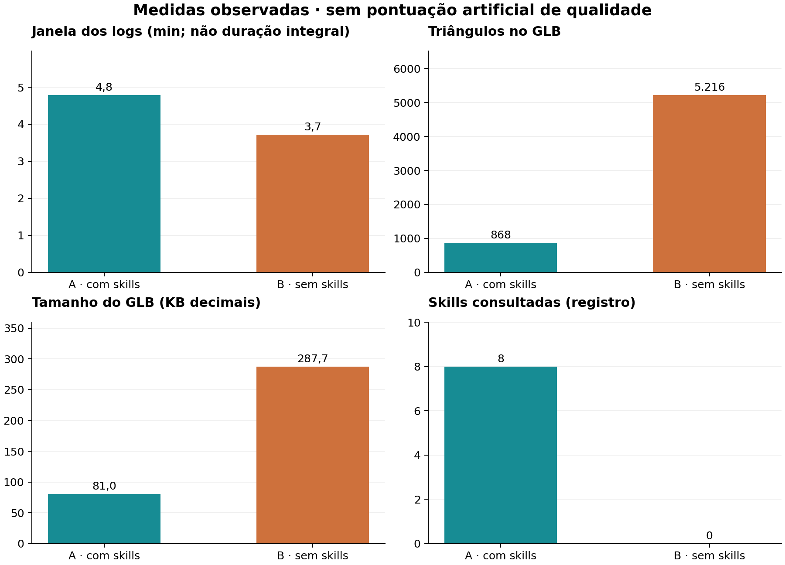
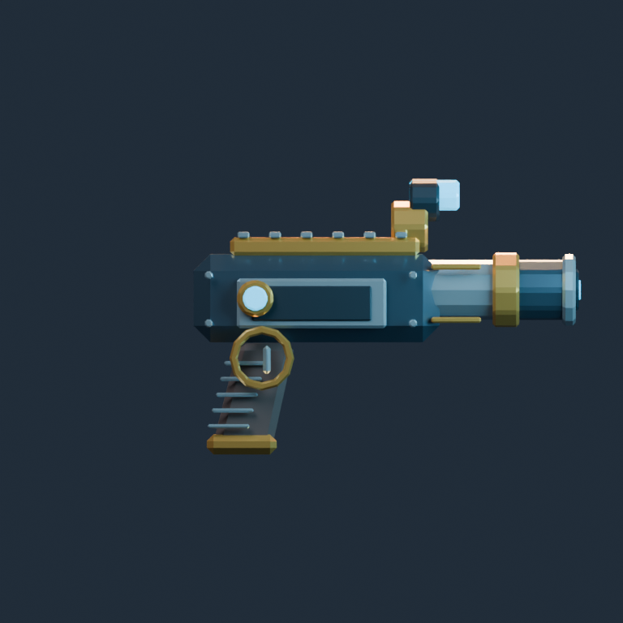
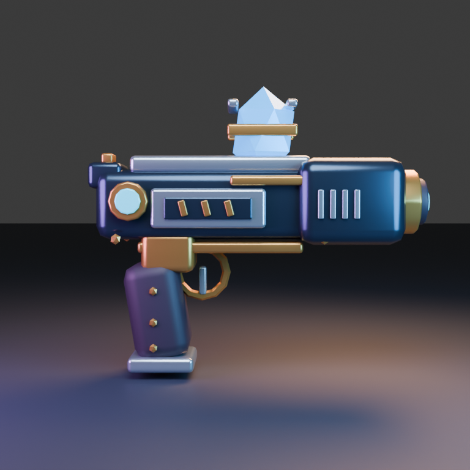
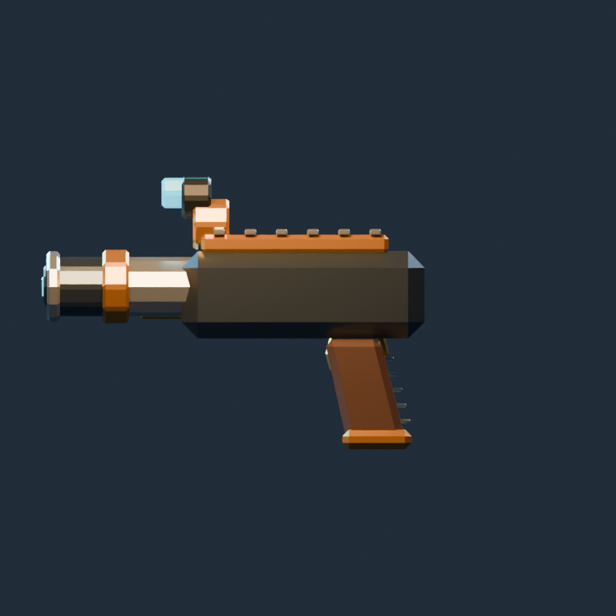
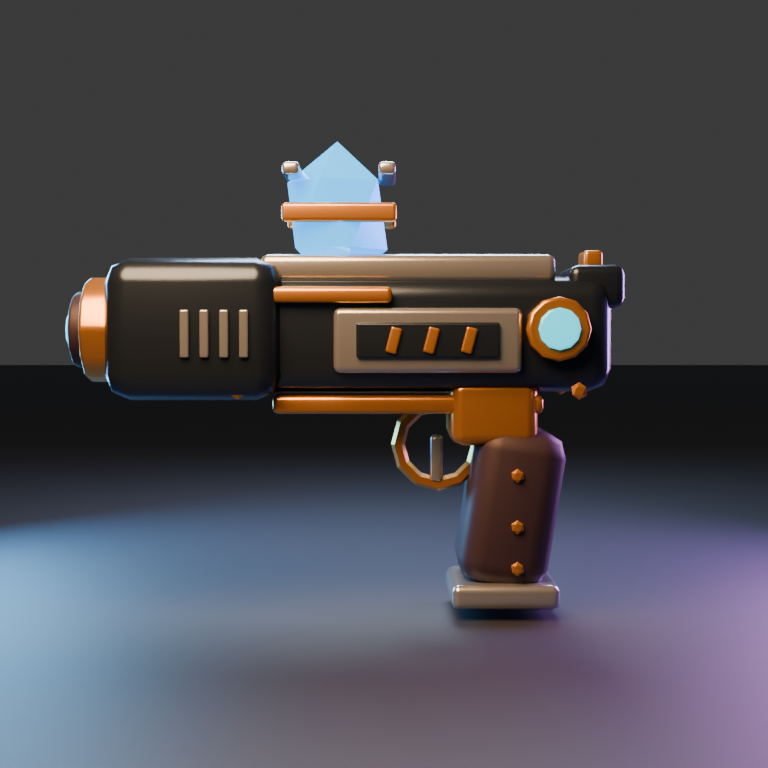
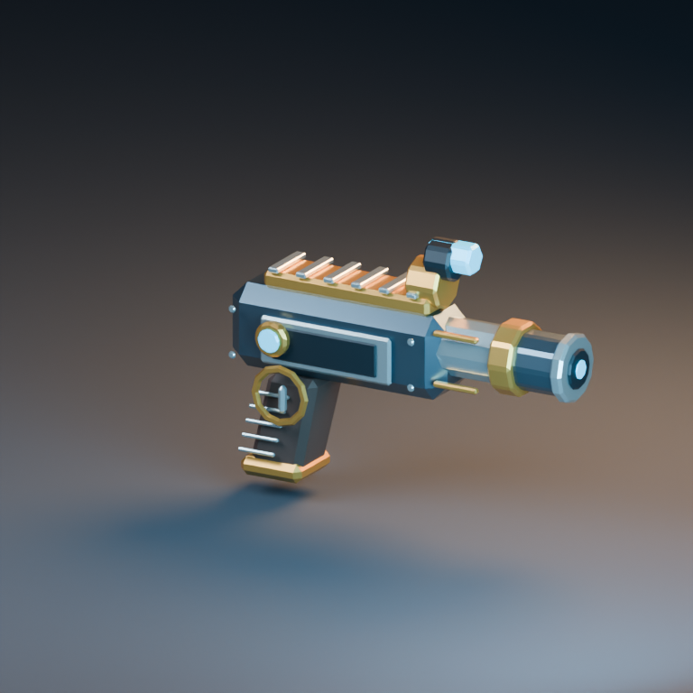
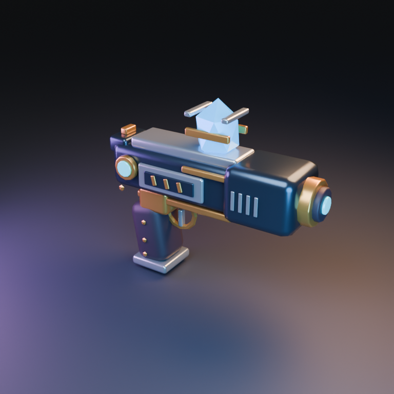

# Blaster arcano: prop de jogo com e sem skills

O blaster sem skills (B) foi minha preferência para o pedido, principalmente pela identidade arcana mais explícita, cristal visível e acabamento nos dois lados. A entrega com skills (A) é muito mais econômica e tem uma linguagem angular low poly consistente. A execução de QA em A não cobriu o objeto solicitado.

A diferença mais objetiva é a economia: A exportou 868 triângulos contra 5.216 de B. A diferença de qualidade depende do critério: B comunica melhor o cristal arcano e os detalhes próximos, enquanto A é útil para um orçamento muito baixo de geometria. A preferência não constitui prova geral contra skills.

## Pedido

Crie no Blender um blaster arcano de mão para um jogo de fantasia científica, em estilo low poly. É um objeto fictício de jogo, com corpo de metal, empunhadura, emissor de cristal e pequenos elementos mecânicos decorativos. Quero uma silhueta reconhecível, materiais bem diferenciados e detalhes que funcionem vistos de perto. A peça deve parecer montada de forma coerente, com acabamento caprichado. Não precisa de animação.

Entregue asset.blend, asset.glb, generate.py e README.md, além de três renders PNG de 768×768 (front.png, back.png e presentation.png), com vistas que permitam avaliar a construção. O GLB deve conter somente o asset e seus materiais; mantenha chão de estúdio, luzes e câmeras fora da exportação. Prefira materiais autossuficientes, sem dependências externas. Revise visualmente suas imagens e corrija os problemas que encontrar antes de concluir. Não basta descrever a cena: gere e verifique os arquivos.

## Medidas

| Medida | A · com skills | B · sem skills |

|---|---:|---:|

| Tempo registrado (s) | 287,0 | 223,0 |

| Skills lidas | 8 | 0 |

| Triângulos exportados | 868 | 5216 |

| Objetos de malha exportados | 36 | 53 |

| Materiais exportados | 6 | 6 |

| Arquivo .blend (bytes) | 127386 | 130924 |

| Arquivo .glb (bytes) | 80956 | 287680 |

| Tokens reais | não disponíveis | não disponíveis |

## Galeria

### Frente

A removeu o piso da vista frontal após notar uma linha de horizonte. B preservou o piso e explicitou essa limitação. Ambas as imagens mostram perfil lateral, apesar do nome front.png. O cristal grande de B comunica a fantasia arcana de forma mais direta.

### Trás

O verso diferencia fortemente as entregas: A concentra seus detalhes em um lado e deixa a outra placa ampla quase lisa. B repete painéis e ornamentação dos dois lados. Isso favorece B quando o asset for visto de vários ângulos; também aumenta geometria.

### Apresentação

A usa cano cilíndrico exposto, corpo angular e detalhes dourados. B dá maior destaque ao cristal e a superfícies arredondadas. O low poly de A é mais estrito; a aparência mais lisa de B vem acompanhada de mais triângulos.

## Resultado A

A entregou 36 objetos de malha, seis materiais e 868 triângulos no GLB. O arquivo GLB tem 80.956 bytes. É uma redução de aproximadamente 83% na geometria e 72% no tamanho do GLB em relação a B. A silhueta é imediatamente reconhecível e a divisão de cores entre corpo, ferragens e empunhadura funciona.

As peças de cristal são menores e lembram um visor ou uma ponta emissiva; a referência a um emissor de cristal fica menos evidente que em B. As nervuras da empunhadura e o círculo de gatilho dão detalhes, mas o verso foi pouco desenvolvido.

O agente observou e corrigiu a linha de horizonte, ocultando o piso nas duas vistas de inspeção. Isso é uma melhoria verificável. Porém, o QA tem um erro de escopo: logs/qa.log contém apenas Studio_Floor no campo objects. O pass=true pertence à checagem do piso, não é evidência de integridade do prop.

A mensagem final inicialmente chamou essa checagem de cena inteira; o registro escrito depois reconhece que mediu o piso em vez da coleção do asset. Esse caso ilustra por que é necessário ler o conteúdo do JSON e não apenas o sinal pass=true. Não corrigi o asset nem o QA em nome do agente.

## Resultado B

B entregou 53 objetos de malha, seis materiais e 5.216 triângulos, com GLB de 287.680 bytes. O cristal azul facetado no topo é bem visível, tem uma fixação decorativa e ajuda a identificar a proposta arcana. Painéis, detalhes metálicos e variações de superfície aparecem em ambos os lados.

Minha preferência visual é por B: a composição e os materiais fazem a peça parecer mais acabada e próxima do pedido de detalhes que funcionam vistos de perto. Isso não mede usabilidade em primeira pessoa, ergonomia ou compatibilidade de engine.

O agente teve falhas de diretório de trabalho: inicialmente procurou generate.py em /workspace e criou diretórios de configuração/log fora da pasta prevista. Depois corrigiu o cwd e concluiu com código zero. A separação por instruções não impediu essa escrita fora da pasta; não houve leitura cruzada observada. Os logs foram preservados.

B reconheceu a linha de horizonte nas vistas secundárias e optou por não corrigi-la. Os bevels e reflexos mais suaves custaram mais geometria. Para um jogo com orçamento estrito, eu reduziria detalhes e segmentos antes da integração.

## Desconstrução da conclusão

Não houve vitória inequívoca em todos os critérios: A é seis vezes mais econômica em triângulos e tem um estilo low poly mais marcado. Se esse for o requisito principal, ela pode ser preferível. Minha escolha por B dá peso ao cristal reconhecível, acabamento bilateral e apresentação.

O pacote disponibiliza conhecimento útil, mas o uso incorreto do QA remove um benefício que se poderia presumir pela simples presença da skill. Ler oito skills e executar um script não demonstra aplicação correta do processo. A checagem independente de importação foi igual para as duas versões.

A e B escolheram direções artísticas diferentes. Formato do cristal, câmera, brilho e quantidade de bevel não foram fixados. O teste compara entregas completas sob o mesmo pedido, não o efeito isolado de uma regra técnica.

A janela de tempo não mede o total de trabalho dos modelos. A retomada do ambiente e os pedidos de conclusão interferem na duração, e o começo da leitura/raciocínio não foi cronometrado. Não uso os 287/223 segundos para afirmar superioridade de velocidade ou custo.

Há uma única execução por condição, sem cegamento ou repetição. Não há contagem real de tokens. A conclusão adequada é um achado de caso: a variante sem skills satisfez melhor minha leitura visual do pedido, e a variante com skills teve grande vantagem em economia geométrica.

## Verificação e limites

Reabri os dois .blend e reimportei os GLBs finais com o mesmo audit_asset.py. Conferi as seis imagens (768 × 768), as contagens de objetos/materiais/triângulos da exportação e a ausência de animações, coerente com o pedido. Nenhum GLB declara URI externa.

As imagens foram abertas para análise visual. Não houve alteração posterior de modelagem pelo avaliador. Não testei empunhadura por um personagem, colisões, motor de jogo, texel density ou orçamento de draw calls.

A retomada do ambiente está registrada em observer-notes.json. As declarações de leitura vêm de skills-read.txt. QA específico e revisão corretiva não foram forçados a ter o mesmo número de ciclos.

## Próximos passos

Se continuar A, tornar o cristal mais explícito e desenvolver o verso; executar o QA sobre a coleção correta.

Se continuar B, reduzir bevels/ornamentos conforme o orçamento do jogo e remover a linha de horizonte das vistas técnicas.

Numa repetição controlada, definir orçamento de geometria, padronizar câmera e separar tempo de leitura, renderização e revisão.

Capturar tokens por chamada no runtime/API; não converter janelas de tempo em estimativas de tokens.

## Skills consultadas

- **[blender-asset-qa](https://github.com/EL4CTEO/blender-skills/blob/fb92cfb4cc5a238c22113a6a230b09f535bd0656/skills/blender-asset-qa/SKILL.md)**: Checagem executada, mas o JSON registra somente Studio_Floor; não validou o blaster.

- **[blender-core](https://github.com/EL4CTEO/blender-skills/blob/fb92cfb4cc5a238c22113a6a230b09f535bd0656/skills/blender-core/SKILL.md)**: Execução e API bpy.

- **[blender-export-pipelines](https://github.com/EL4CTEO/blender-skills/blob/fb92cfb4cc5a238c22113a6a230b09f535bd0656/skills/blender-export-pipelines/SKILL.md)**: Exportação GLB e seleção do asset.

- **[blender-hardsurface-modeling](https://github.com/EL4CTEO/blender-skills/blob/fb92cfb4cc5a238c22113a6a230b09f535bd0656/skills/blender-hardsurface-modeling/SKILL.md)**: Primitivas, bevels e montagem de prop.

- **[blender-lighting-lookdev](https://github.com/EL4CTEO/blender-skills/blob/fb92cfb4cc5a238c22113a6a230b09f535bd0656/skills/blender-lighting-lookdev/SKILL.md)**: Apresentação de produto e enquadramento.

- **[blender-pbr-materials](https://github.com/EL4CTEO/blender-skills/blob/fb92cfb4cc5a238c22113a6a230b09f535bd0656/skills/blender-pbr-materials/SKILL.md)**: Materiais metal/roughness e emissão.

- **[blender-pipeline-automation](https://github.com/EL4CTEO/blender-skills/blob/fb92cfb4cc5a238c22113a6a230b09f535bd0656/skills/blender-pipeline-automation/SKILL.md)**: Rotina headless e geração por script.

- **[blender-rendering](https://github.com/EL4CTEO/blender-skills/blob/fb92cfb4cc5a238c22113a6a230b09f535bd0656/skills/blender-rendering/SKILL.md)**: Saída Cycles e múltiplas câmeras.

Nenhuma skill foi modificada. Tokens reais indisponíveis. Modelo gpt-6-luna medium, Blender 5.2.3, uma execução por condição; avaliação não cega. Veja o PDF e o manifesto para detalhes.