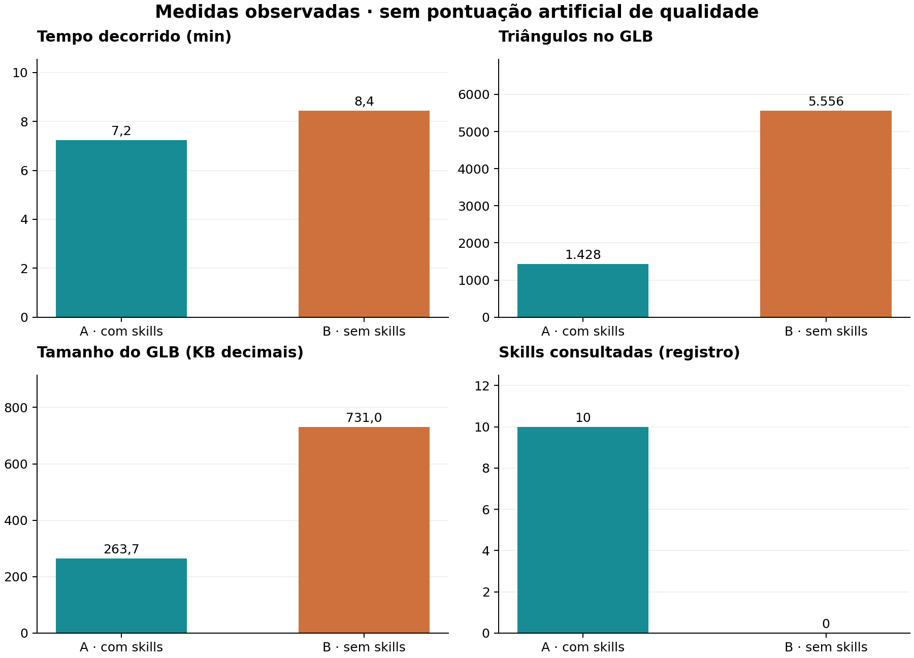
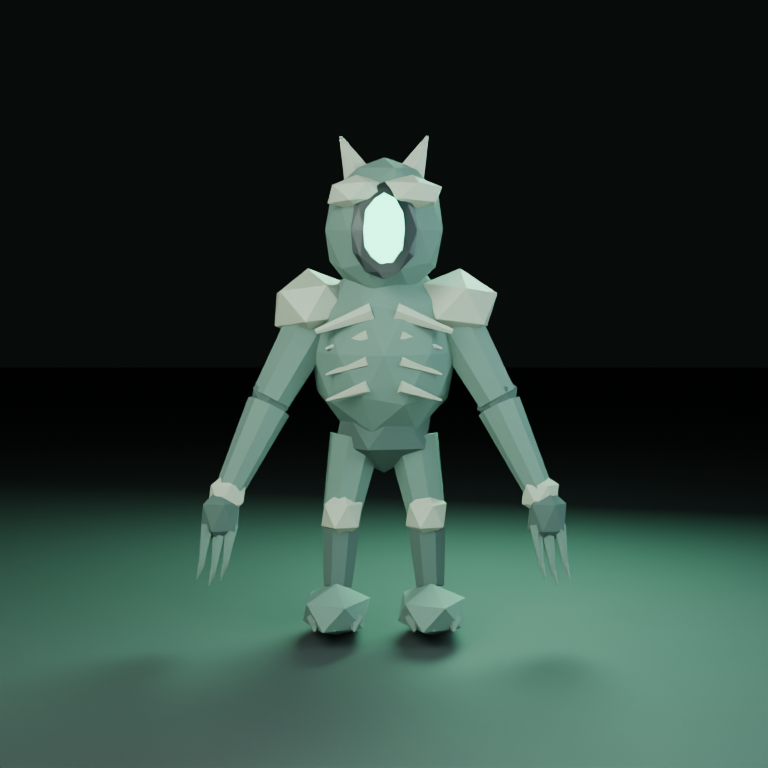
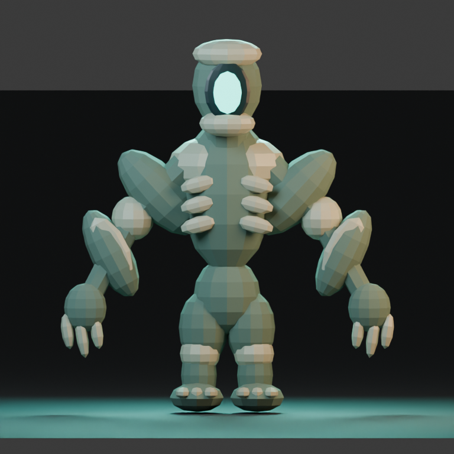
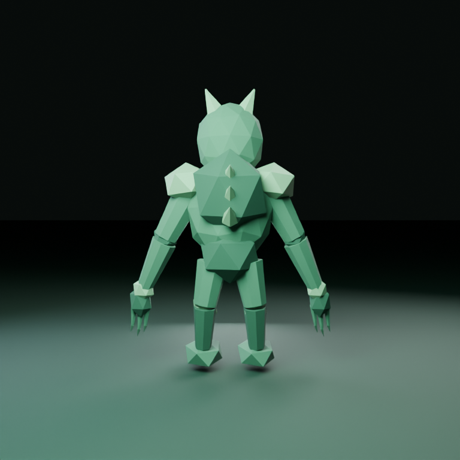
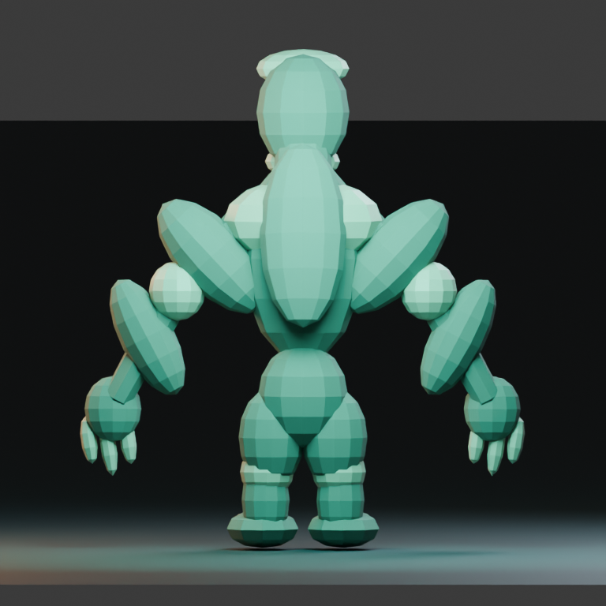
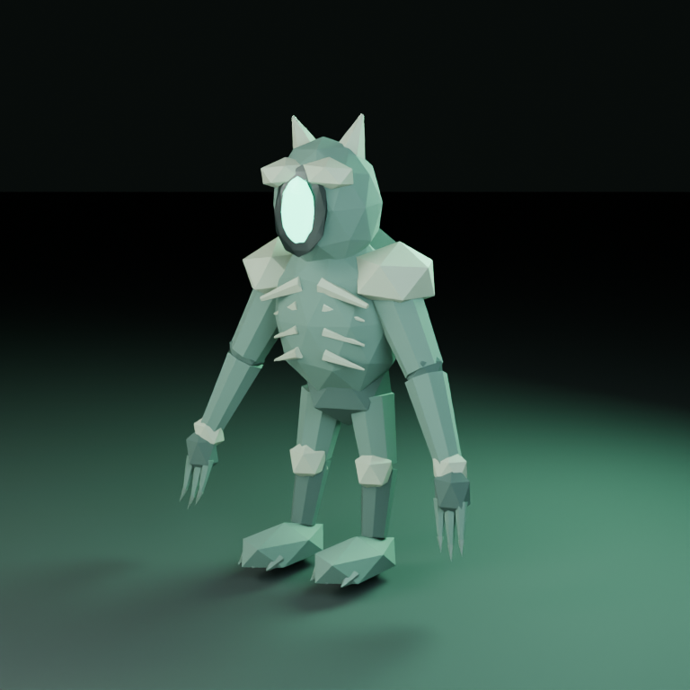
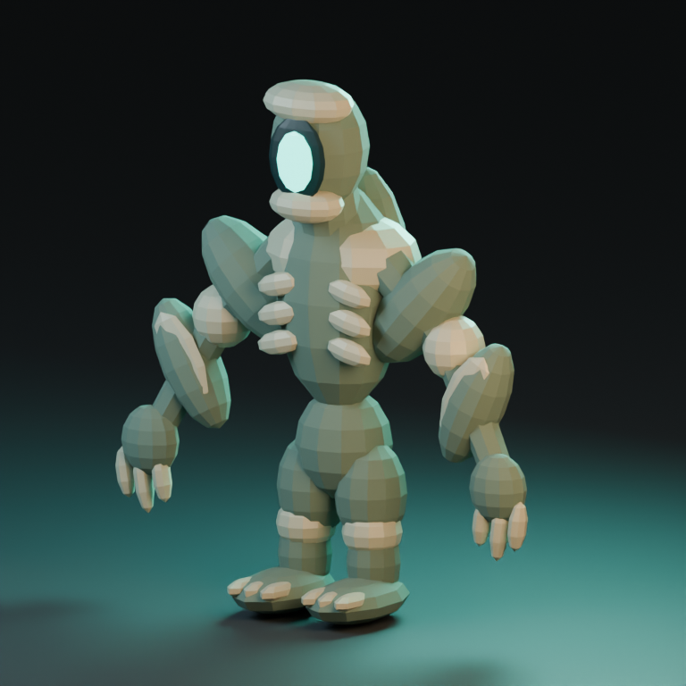

# Vigia do Brejo: criatura com rig e idle

Neste par, a versão com skills (A) foi minha preferência: tem silhueta mais coerente, membros alongados e placas ósseas legíveis com 1.428 triângulos exportados. B também entregou rig e animação funcionais, mas ficou mais volumosa e segmentada, com 5.556 triângulos. Nenhuma transmite plenamente uma criatura curvada e organicamente aterrorizante.

As duas animações finais mudam de pose depois de reimportadas. A vantagem de A neste caso está na coerência e economia, não em ser a única versão que anima. B detectou e corrigiu um erro de keyframes constantes antes de entregar. O resultado contradiz qualquer regra simples de que dispensar skills seria sempre melhor.

## Pedido

Crie no Blender uma criatura de terror low poly chamada Vigia do Brejo, para um jogo: humanoide curvada, braços compridos, cabeça sem olhos com abertura luminosa, pés largos e silhueta perturbadora. Sem sangue ou violência explícita. Quero anatomia estilizada coerente, corpo articulável e materiais que diferenciem pele, placas ósseas e brilho. Faça um rig simples e uma animação idle de 48 quadros a 24 fps, com respiração e um movimento sutil da cabeça e dos braços. Inclua a animação no GLB e três imagens adicionais dos quadros 1, 24 e 48 (pose-01.png, pose-24.png, pose-48.png), para eu conferir a deformação.

Entregue asset.blend, asset.glb, generate.py e README.md, além de três renders PNG de 768×768 (front.png, back.png e presentation.png), com vistas que permitam avaliar a construção. O GLB deve conter somente o asset e seus materiais; mantenha chão de estúdio, luzes e câmeras fora da exportação. Prefira materiais autossuficientes, sem dependências externas. Revise visualmente suas imagens e corrija os problemas que encontrar antes de concluir. Não basta descrever a cena: gere e verifique os arquivos.

## Medidas

| Medida | A · com skills | B · sem skills |
|---|---:|---:|
| Tempo registrado (s) | 434,0 | 506,0 |
| Skills lidas | 10 | 0 |
| Triângulos exportados | 1428 | 5556 |
| Objetos de malha exportados | 59 | 50 |
| Materiais exportados | 6 | 4 |
| Arquivo .blend (bytes) | 148365 | 173806 |
| Arquivo .glb (bytes) | 263736 | 731048 |
| Polígonos na fonte, antes de modificadores | 954 | 3228 |
| Triângulos na fonte, antes de modificadores | 1428 | 5556 |
| Triângulos avaliados no .blend | 1428 | 5556 |
| Vértices de posição, por instância | 3336 | 12012 |
| Definições de malha no GLB | 59 | 50 |
| Triângulos nas definições de malha | 1428 | 5556 |
| Clipes de animação no GLB | 1 | 1 |
| Dimensões XYZ (unidades da cena) | 1.859 × 1.106 × 2.523 | 2.972 × 1.141 × 3.331 |
| Tokens reais | não disponíveis | não disponíveis |

## Galeria

### Frente

A tem braços longos, garras finas e formas ósseas mais pontudas. B tem membros volumosos, mãos grandes e articulações esféricas aparentes, aproximando-se de um boneco articulado. Ambas respeitam a ausência de olhos e a abertura luminosa.

### Trás

O verso mostra a carapaça/placas e a segmentação dos membros. Em B, as junções e hastes de ligação são mais evidentes; em A, os contornos se aproximam de um humanoide esguio, embora a pele continue formada por peças separadas.

### Apresentação

As duas têm iluminação esverdeada e fundo escuro. A me parece mais próxima do terror estilizado; B tem leitura mais robusta e cartunesca. Ambas estão relativamente eretas e perdem parte da postura curvada solicitada. Não medi percepção de medo com outros avaliadores.

## Resultado A

A exportou 59 objetos de malha, seis materiais efetivamente importados, uma armature com 17 ossos e 1.428 triângulos. O GLB ocupa 263.736 bytes e contém um skin e uma animação com 51 canais. As medidas são da auditoria independente da exportação, distintas das contagens de malha base e materiais totais citadas pelo agente.

A silhueta esguia, os dedos compridos e os elementos pontudos funcionam melhor para meu entendimento do pedido. A região luminosa sem olhos é clara. As placas ósseas se distinguem da pele, mas o resultado ainda parece um personagem montado a partir de primitivas. A postura curvada não é suficientemente marcada.

A auditoria do GLB detectou deslocamento máximo de aproximadamente 0,056 unidade em relação ao quadro 1 nos quadros amostrados. A animação é sutil, conforme o pedido. A reprodução entre primeiro e último quadro tem pequena diferença residual; não analisei continuidade de velocidades em todos os ossos.

O agente corrigiu seu teste de reimportação para limpar o cubo, a câmera e a luz default antes de importar. Esse detalhe evita falsos positivos sobre objetos de estúdio no GLB. Reduziu amostras de 24 para 6 após uma execução interrompida e registrou uma ressalva de contato com o piso de cerca de 1 cm.

## Resultado B

B exportou 50 objetos de malha, quatro materiais importados, rig com 17 ossos e 5.556 triângulos. O GLB tem 731.048 bytes e inclui um skin e 51 canais de animação. A maior densidade de geometria não produziu, na minha avaliação, uma anatomia mais convincente.

A massa nos ombros e nas articulações, o formato arredondado das placas e a distribuição dos braços fazem a criatura parecer mais um boneco ou robô. O agente adicionou hastes para conectar segmentos após perceber espaços entre as formas. Isso ajuda na ligação, mas a segmentação segue muito visível.

B encontrou primeiro uma incompatibilidade de Action.fcurves no Blender 5.2. Depois detectou que suas chaves guardavam valores idênticos porque a inserção estava fora do laço de poses. Corrigiu a inserção, regenerou cenas e imagens e comprovou diferenças. O arquivo final tem movimento real no GLB; a falha intermediária não foi tratada como resultado final.

Nos quadros amostrados, o deslocamento máximo atingiu cerca de 0,117 unidade, e o quadro 48 coincide com o quadro 1. Maior amplitude não é, por si, um mérito. O agente usou oito samples no render final e reconheceu a aparência facetada/segmentada como limitação.

## Desconstrução da conclusão

A venceu minha avaliação equilibrada neste pedido, mas não entregou uma criatura plenamente orgânica, curvada e assustadora. Proporção, postura e intenção artística continuam limitadas. A boa economia de triângulos não corrige requisitos visuais parcialmente atendidos.

O agente sem skills também conseguiu rig, skin e exportação animada depois de revisar. Portanto, não se pode concluir que as skills sejam necessárias para esse pipeline. Elas coincidiram com melhor resultado neste caso e com um fluxo diferente de correção.

Dez skills consultadas não equivalem a dez técnicas aplicadas com sucesso. A referência de escultura foi lida, mas o asset segue construído por partes. O teste não separa ajuda de API, orientação de proporções, QA e escolhas do modelo.

Os renders de 6 e 8 samples e as escolhas de iluminação não foram igualados. Ruído, suavidade e apresentação podem afetar preferências. Os tempos incluem correções, renderizações interrompidas e execução em máquina compartilhada.

Movimento confirmado por vértices e canais não prova qualidade de skinning em poses extremas, ausência de interpenetração entre todos os frames ou continuidade perfeita do loop. Não houve walk cycle, retargeting ou teste em engine. Uma amostra por condição e julgamento não cego continuam limitando a conclusão.

Também foi necessário desconstruir minha própria contagem: objetos auxiliares criados pelo importador não pertencem à geometria exportada. Por isso, além de reimportar, conferi as definições e instâncias diretamente no glTF e preservei o erro inicial no histórico. Isso altera números da primeira versão do PDF, sem mudar minha preferência visual por A.

## Verificação e limites

Apliquei o mesmo audit_asset.py aos dois .blend e aos dois GLBs finais. Ambos abriram, reimportaram e apresentaram movimento em quadros amostrados. A análise registra bones, armatures, modificadores de deformação, skins e canais de animação. Não há URIs externas nos GLBs.

Conferi as dimensões dos doze PNGs de entrega e abri as vistas e amostras de poses para inspeção. Apresentação e pose-01 usam o mesmo enquadramento e estado inicial; não são vistas independentes para avaliar amplitude. A confirmação de movimento vem dos vértices avaliados no .blend e no GLB, não da existência de nomes de arquivos diferentes.

A primeira auditoria somava uma Icosphere auxiliar criada pelo importador para exibir ossos: eram 80 triângulos e uma malha a mais em cada variante. Excluí esse objeto por sua referência como custom_shape, repeti a inspeção e confirmei as contagens no próprio glTF: A 1.428 triângulos/59 malhas, B 5.556/50. Os JSONs iniciais foram preservados como *.initial-with-helper.json e o diagnóstico em importer-helper-diagnosis.log. O agente A já havia informado 1.428; a divergência anterior vinha do meu contador. Não alterei os assets.

## Próximos passos

Reforçar a postura curvada e a silhueta de terror em ambas; melhorar a ligação anatômica de ombros, cotovelos e quadris.

Testar poses extremas e contatos do pé, não apenas um idle sutil. Medir também continuidade de velocidade no loop.

Usar câmeras e iluminação neutras padronizadas numa avaliação adicional; preservar a apresentação artística como critério separado.

Repetir execuções e usar telemetria de tokens se o objetivo for estimar custo de correções e leitura de skills.

## Skills consultadas

- **[blender-animation](https://github.com/EL4CTEO/blender-skills/blob/fb92cfb4cc5a238c22113a6a230b09f535bd0656/skills/blender-animation/SKILL.md)**: Idle de aproximadamente dois segundos; movimento confirmado após importação.

- **[blender-asset-qa](https://github.com/EL4CTEO/blender-skills/blob/fb92cfb4cc5a238c22113a6a230b09f535bd0656/skills/blender-asset-qa/SKILL.md)**: Log de checagem e ressalva de contato com o piso.

- **[blender-character-rigging](https://github.com/EL4CTEO/blender-skills/blob/fb92cfb4cc5a238c22113a6a230b09f535bd0656/skills/blender-character-rigging/SKILL.md)**: Rig e skinning; rig de 17 ossos presente no GLB.

- **[blender-core](https://github.com/EL4CTEO/blender-skills/blob/fb92cfb4cc5a238c22113a6a230b09f535bd0656/skills/blender-core/SKILL.md)**: Execução, API e encaminhamento.

- **[blender-export-pipelines](https://github.com/EL4CTEO/blender-skills/blob/fb92cfb4cc5a238c22113a6a230b09f535bd0656/skills/blender-export-pipelines/SKILL.md)**: GLB com rig, skin e animação.

- **[blender-lighting-lookdev](https://github.com/EL4CTEO/blender-skills/blob/fb92cfb4cc5a238c22113a6a230b09f535bd0656/skills/blender-lighting-lookdev/SKILL.md)**: Apresentação com luzes e câmeras.

- **[blender-pbr-materials](https://github.com/EL4CTEO/blender-skills/blob/fb92cfb4cc5a238c22113a6a230b09f535bd0656/skills/blender-pbr-materials/SKILL.md)**: Pele, placas e emissão separadas.

- **[blender-rendering](https://github.com/EL4CTEO/blender-skills/blob/fb92cfb4cc5a238c22113a6a230b09f535bd0656/skills/blender-rendering/SKILL.md)**: Renders e poses; amostragem reduzida para completar a execução.

- **[blender-scene-setup](https://github.com/EL4CTEO/blender-skills/blob/fb92cfb4cc5a238c22113a6a230b09f535bd0656/skills/blender-scene-setup/SKILL.md)**: Unidades, coleções e organização.

- **[blender-sculpting](https://github.com/EL4CTEO/blender-skills/blob/fb92cfb4cc5a238c22113a6a230b09f535bd0656/skills/blender-sculpting/SKILL.md)**: Construção de formas orgânicas; também leu forms-and-bake-sources.md. A entrega usa formas segmentadas, não escultura contínua.

Nenhuma skill foi modificada. Tokens reais indisponíveis. Modelo gpt-6-luna medium, Blender 5.2.3, uma execução por condição; avaliação não cega. Veja o PDF e o manifesto para detalhes.