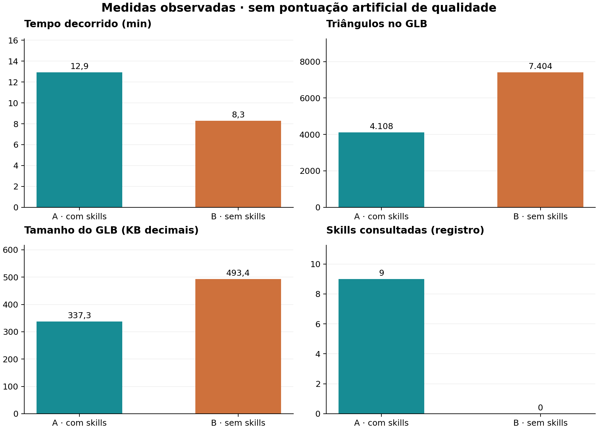
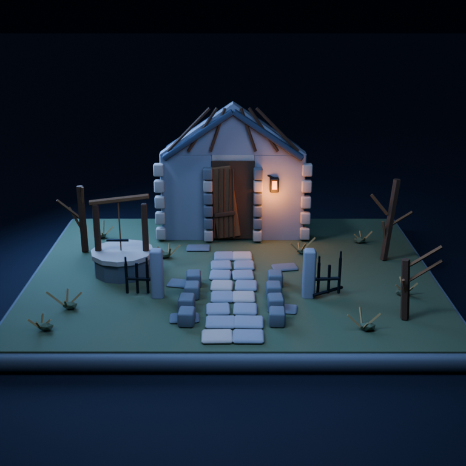
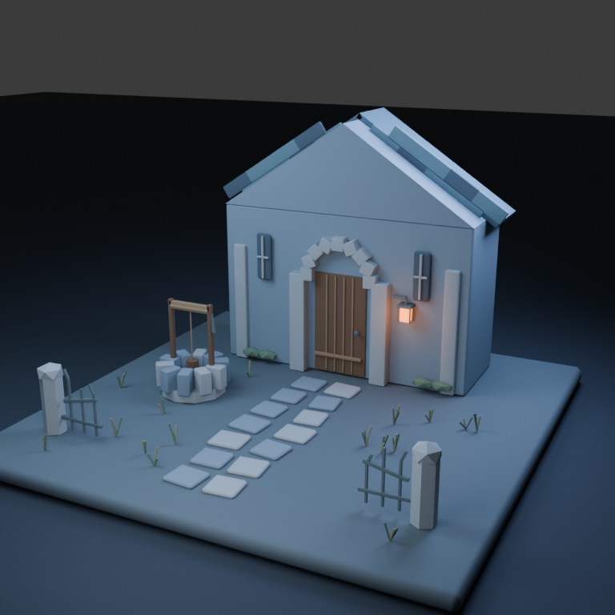
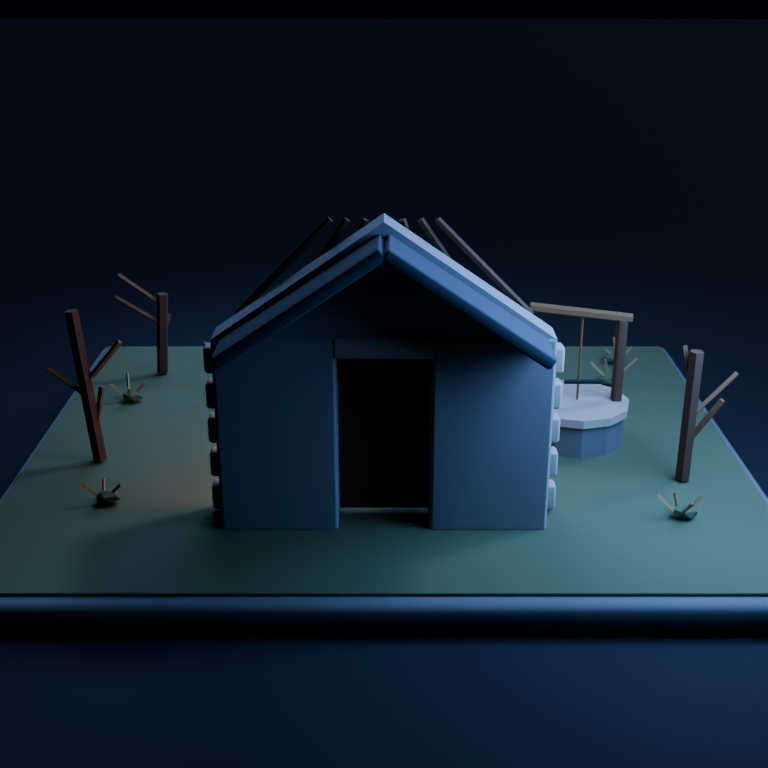
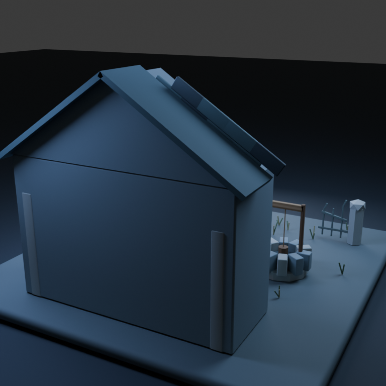
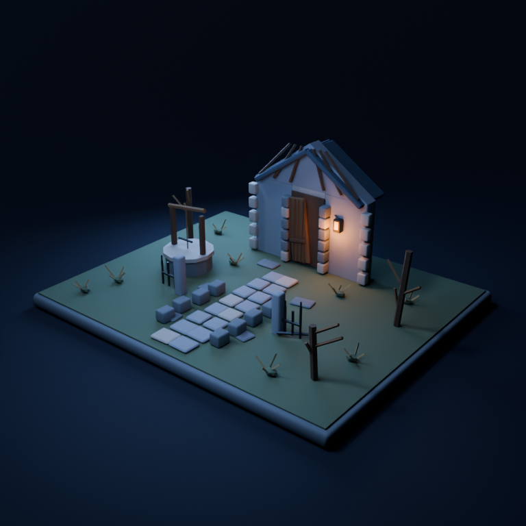
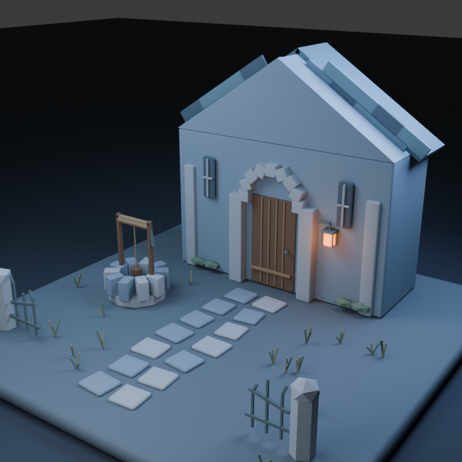

# Capela abandonada: cenário estático e composição

Prefiro A, com skills, para este pedido de diorama noturno: caminho central claro, árvores secas e telhado deteriorado reforçam a composição de abandono, com menos geometria. B tem uma fachada mais monumental, arco decorado e poço detalhado, mas sua apresentação aproxima e corta elementos periféricos. A levou mais tempo e passou por várias correções de QA.

A preferência inclui direção de arte, iluminação e enquadramento, que não foram padronizados. A trata a capela como fachada/cenografia, e B constrói um volume mais fechado. Isso é permitido pelo pedido, mas impede atribuir toda a diferença de triângulos a otimização superior. Nenhuma passagem foi validada com personagem ou colisão.

## Pedido

Crie no Blender um pequeno pátio de capela abandonada para um jogo de terror estilizado low poly. Inclua a fachada e entrada da capela, um caminho de pedra que se possa percorrer, portão quebrado, poço e vegetação esparsa. Quero uma composição que conduza o olhar até a entrada, escala coerente e iluminação de luar com uma fonte quente perto da porta. Capriche na sensação de abandono sem usar sangue. A cena deve funcionar como um pequeno diorama completo, com os elementos apoiados de forma convincente. Não precisa de animação.

Entregue asset.blend, asset.glb, generate.py e README.md, além de três renders PNG de 768×768 (front.png, back.png e presentation.png), com vistas que permitam avaliar a construção. O GLB deve conter somente o asset e seus materiais; mantenha chão de estúdio, luzes e câmeras fora da exportação. Prefira materiais autossuficientes, sem dependências externas. Revise visualmente suas imagens e corrija os problemas que encontrar antes de concluir. Não basta descrever a cena: gere e verifique os arquivos.

## Medidas

| Medida | A · com skills | B · sem skills |
|---|---:|---:|
| Tempo registrado (s) | 775,0 | 497,0 |
| Skills lidas | 9 | 0 |
| Triângulos exportados | 4108 | 7404 |
| Objetos de malha exportados | 151 | 175 |
| Materiais exportados | 11 | 12 |
| Arquivo .blend (bytes) | 179728 | 196825 |
| Arquivo .glb (bytes) | 337284 | 493376 |
| Polígonos na fonte, antes de modificadores | 1040 | 1223 |
| Triângulos na fonte, antes de modificadores | 1964 | 2296 |
| Triângulos avaliados no .blend | 4108 | 7404 |
| Vértices de posição, por instância | 6347 | 9665 |
| Definições de malha no GLB | 151 | 175 |
| Triângulos nas definições de malha | 4108 | 7404 |
| Clipes de animação no GLB | 0 | 0 |
| Dimensões XYZ (unidades da cena) | 10.200 × 8.400 × 4.310 | 14.000 × 14.000 × 8.855 |
| Tokens reais | não disponíveis | não disponíveis |

## Galeria

### Frente

A centraliza o caminho e usa árvores secas, alvenaria irregular e uma porta torta para sugerir abandono. B dá mais espaço visual à capela e às molduras; sua vista frontal é oblíqua, enquanto A oferece uma leitura mais direta do eixo do caminho.

### Trás

A mostra o caráter de fachada do cenário e uma abertura no verso. B fecha o edifício e deixa a parede traseira lisa, limitação que o agente registrou. O pedido citava fachada, portanto não classifico automaticamente a diferença de fechamento como erro de A.

### Apresentação

A mostra o terreno inteiro numa vista mais ampla e escura. B aproxima a fachada e corta parte do portão/limite do diorama na apresentação; a vista frontal de B mostra mais do conjunto. Preferir A nesta imagem também é preferir seu enquadramento, não apenas sua malha.

## Resultado A

A exportou 151 objetos de malha, 11 materiais e 4.108 triângulos, com GLB de 337.284 bytes. O caminho central conduz à porta, o poço ocupa um lado sem encobrir o eixo principal e árvores secas equilibram a outra área. A luz quente perto da entrada contrasta com o tom frio geral.

A deterioração é comunicada por elementos geométricos simples: caibros expostos, porta irregular, vegetação e pedras soltas. Os materiais são majoritariamente cores e parâmetros básicos; não há uma demonstração de texturização detalhada de desgaste. A arquitetura é cenográfica e não um edifício completo testado por dentro.

O QA inicial conferiu 153 objetos e encontrou geometria degenerada no terreno, UV ausente no frontão e escala não aplicada em pedras. Preservei esse JSON intermediário em observer-qa-first.json. O agente corrigiu esses pontos, ajustou contatos da lanterna e acabou removendo duas hastes decorativas que continuavam sendo marcadas como soltas.

O resultado final relatou zero erros e 34 avisos de n-gons/coincidências intencionais aceitos. Isso é distinto de “sem avisos”. O tempo registrado foi de 12 min 55 s. A auditoria independente confirmou importação, contagem e ausência de câmeras/luzes no GLB; não garante validade de todos os contatos nem física do cenário.

## Resultado B

B exportou 175 objetos de malha, 12 materiais e 7.404 triângulos, em GLB de 493.376 bytes. A fachada tem pedras em torno da porta e elementos em cruz nas janelas; o poço usa um aro de pedras mais individualizadas. Esses detalhes dão identidade arquitetônica clara.

A composição é mais monumental e menos sombria que A. O terreno é amplo e o caminho parece legível, mas a câmera de apresentação reduz a leitura do portão e das bordas. A parede posterior lisa foi uma escolha/limitação declarada, não uma parte que o agente tentou esconder do relatório.

A revisão visual detectou placas do telhado fora do plano e o agente reposicionou essas peças e regenerou a cena. Também corrigiu uma falha inicial de diretórios/logs. Em uma reimportação, confundiu inicialmente os objetos default da cena com itens exportados; a inspeção do glTF confirmou ausência de câmeras/luzes e o exportador passou a desligar explicitamente esses itens.

B perguntou sobre outros PIDs do Blender. Esclareci apenas que a máquina compartilhada tinha outras tarefas e que seus comandos deveriam usar caminhos próprios. Não compartilhei imagens, código ou orientação artística de A. Não há evidência de que outro fluxo tenha sobrescrito seus resultados. A ocorrência está no registro do observador.

## Desconstrução da conclusão

A teve uma revisão de geometria mais sistemática e meu resultado visual preferido. Isso não prova que todos os ciclos de correção tiveram retorno proporcional: houve várias renderizações completas para pequenos contatos de lanterna, e parte do detalhe acabou removida para satisfazer o verificador.

A também fez um cenário com interpretação diferente da capela: uma fachada cenográfica mais simples, contra um volume fechado em B. Os 44% a menos de triângulos e cerca de 32% a menos no GLB não são uma comparação de duas implementações da mesma malha.

B apresenta detalhes de arquitetura atraentes e pode ser o ponto de partida preferido de outro diretor de arte. A iluminação e o enquadramento favorecem minha escolha por A, mas não isolei o efeito desses fatores. Não atribuo uma nota objetiva à sensação de abandono.

Zero erros no QA não mede se o caminho é confortável de percorrer, se a porta tem largura para o avatar ou se a iluminação funciona em runtime. Ambas entregam um diorama para inspeção, sem teste de navegação, colisão ou engine.

A maior duração de A não permite inferir tokens consumidos. Os logs misturam preparação, falhas, correções e render. Uma intervenção operacional adicional em B e um pedido de andamento em A também devem ser divulgados, embora não tenham fornecido dicas artísticas. Uma única execução por condição e avaliação não cega continuam sendo limites centrais.

## Verificação e limites

Reabri os .blend finais e reimportei os dois GLBs em cenas limpas com o mesmo script. Conferi os seis PNGs em 768 × 768 e inspecionei as vistas. Ambos exportam geometria estática sem animações, sem URIs externas e sem nós de câmera/luz no glTF.

Comparei a cobertura do QA de A com o log inicial, os registros de correções e o resultado final declarado. Não apliquei esse pacote de QA à versão B para inventar uma taxa comparável de aprovação. A inspeção independente de importação e contagem foi a mesma para ambas.

Não alterei materiais, câmeras ou modelos dos agentes. A imagem de apresentação de A foi inspecionada durante a fase final de correções; as vistas frontal/traseira finais e os arquivos preservados documentam a entrega. Todos os dados estão junto aos logs e observer-notes.json.

## Próximos passos

Para produção, definir se a capela será apenas fachada ou edifício explorável; essa decisão muda o orçamento e a avaliação de completude.

Padronizar uma câmera ampla que mostre todo o pátio e uma câmera de circulação ao nível do personagem.

Validar largura de caminho e acesso com volumes de colisão representativos no engine; o render não substitui esse teste.

Manter uma checagem de cobertura do QA: confirmar que ele examinou o conjunto exportado, e revisar semanticamente os resultados em vez de perseguir apenas pass=true.

## Skills consultadas

- **[blender-asset-qa](https://github.com/EL4CTEO/blender-skills/blob/fb92cfb4cc5a238c22113a6a230b09f535bd0656/skills/blender-asset-qa/SKILL.md)**: Encontrou problemas reais no terreno/UV/escala e motivou várias revisões; 34 avisos foram aceitos na entrega.

- **[blender-core](https://github.com/EL4CTEO/blender-skills/blob/fb92cfb4cc5a238c22113a6a230b09f535bd0656/skills/blender-core/SKILL.md)**: Execução e API.

- **[blender-environment-kits](https://github.com/EL4CTEO/blender-skills/blob/fb92cfb4cc5a238c22113a6a230b09f535bd0656/skills/blender-environment-kits/SKILL.md)**: Diorama, distribuição e elementos de cenário.

- **[blender-export-pipelines](https://github.com/EL4CTEO/blender-skills/blob/fb92cfb4cc5a238c22113a6a230b09f535bd0656/skills/blender-export-pipelines/SKILL.md)**: Separação do cenário de estúdio e GLB.

- **[blender-lighting-lookdev](https://github.com/EL4CTEO/blender-skills/blob/fb92cfb4cc5a238c22113a6a230b09f535bd0656/skills/blender-lighting-lookdev/SKILL.md)**: Contraste entre luar e lanterna.

- **[blender-pipeline-automation](https://github.com/EL4CTEO/blender-skills/blob/fb92cfb4cc5a238c22113a6a230b09f535bd0656/skills/blender-pipeline-automation/SKILL.md)**: Geração por script e verificações headless.

- **[blender-rendering](https://github.com/EL4CTEO/blender-skills/blob/fb92cfb4cc5a238c22113a6a230b09f535bd0656/skills/blender-rendering/SKILL.md)**: Saída em três vistas.

- **[blender-scene-setup](https://github.com/EL4CTEO/blender-skills/blob/fb92cfb4cc5a238c22113a6a230b09f535bd0656/skills/blender-scene-setup/SKILL.md)**: Unidades, coleções e transformações.

- **[blender-time-of-day](https://github.com/EL4CTEO/blender-skills/blob/fb92cfb4cc5a238c22113a6a230b09f535bd0656/skills/blender-time-of-day/SKILL.md)**: Iluminação noturna e atmosfera.

Nenhuma skill foi modificada. Tokens reais indisponíveis. Modelo gpt-6-luna medium, Blender 5.2.3, uma execução por condição; avaliação não cega. Veja o PDF e o manifesto para detalhes.