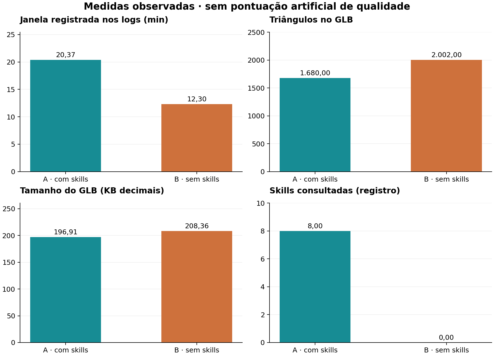
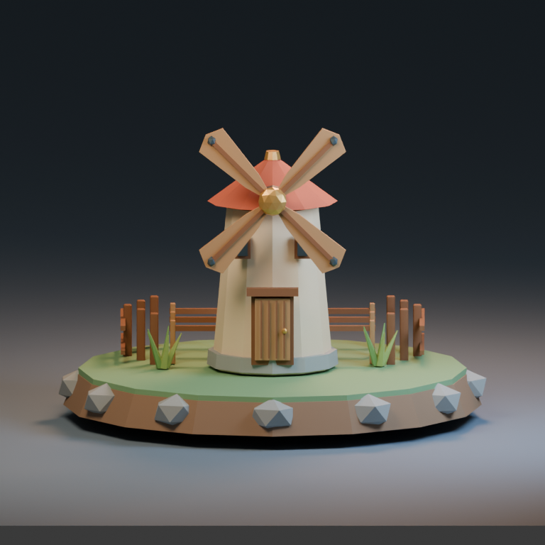
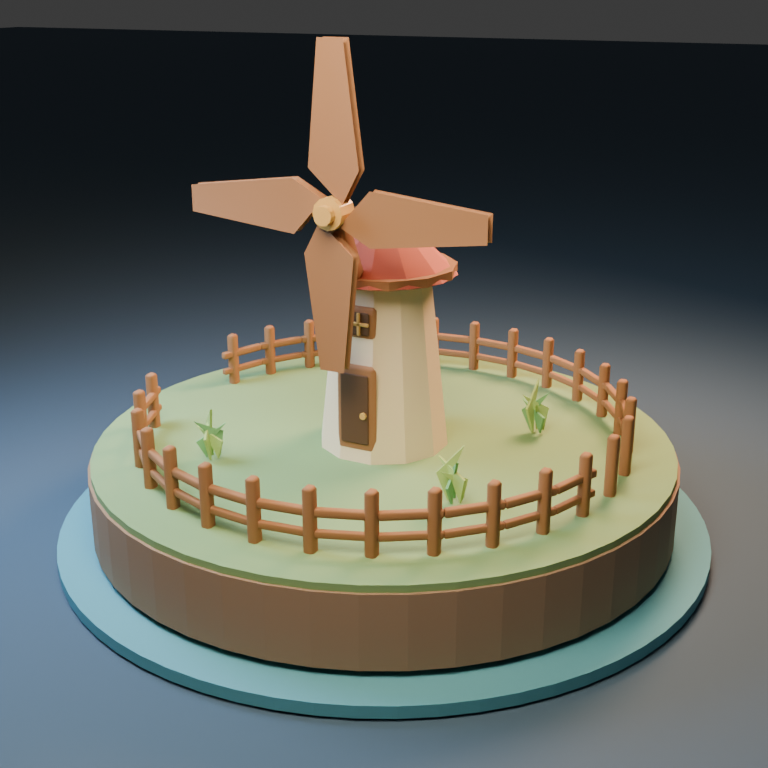
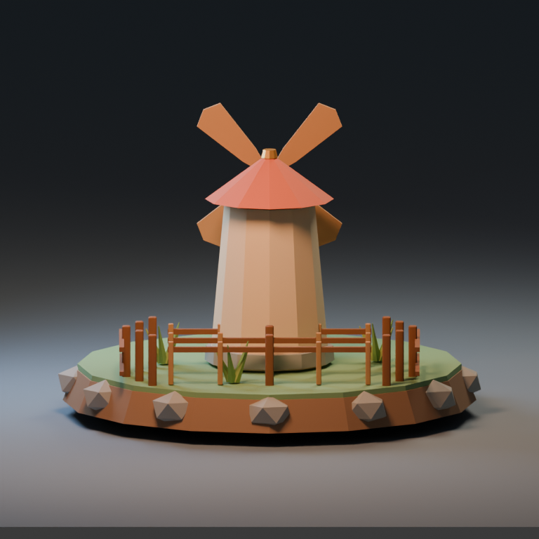
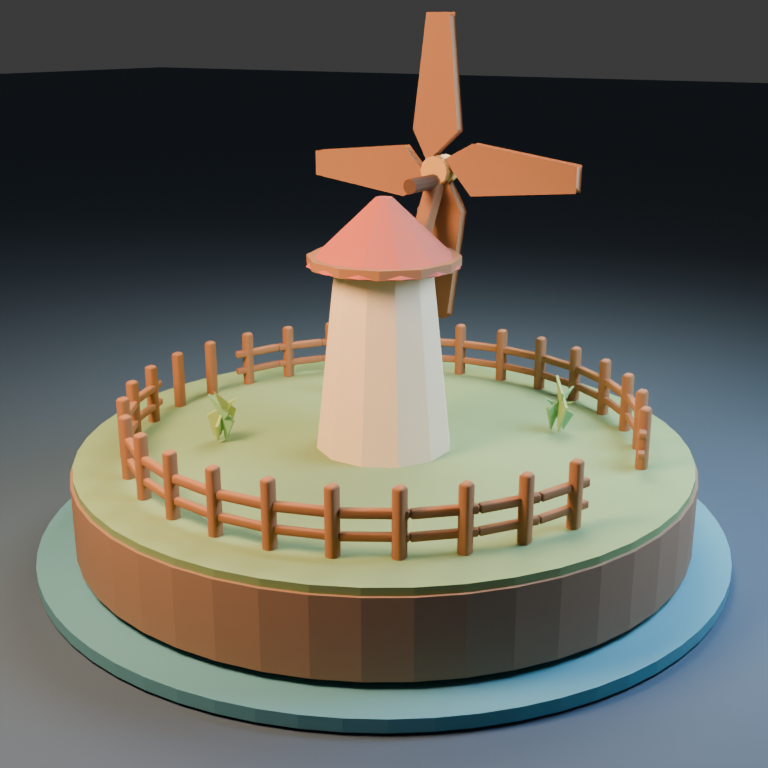
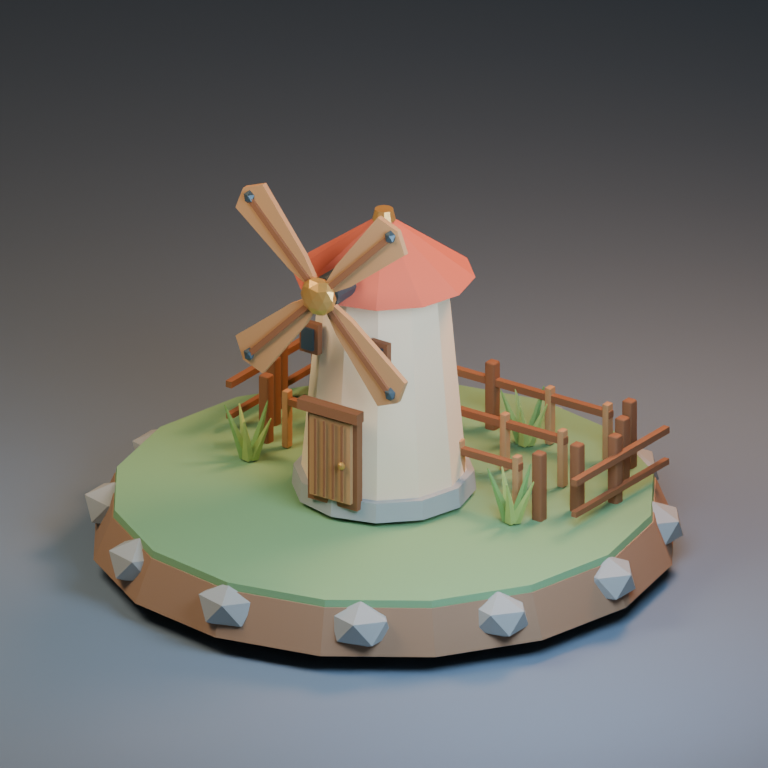
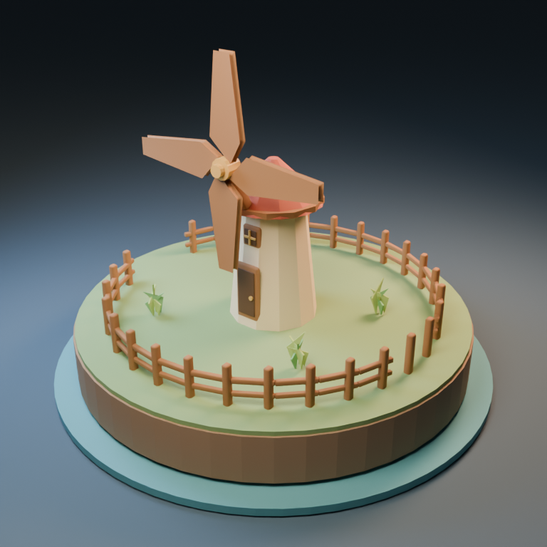

# Moinho: cenário animado, exportação e interseções

Minha preferência equilibrada foi ligeiramente por A, com skills: proporções compactas, pás com detalhes e base mais trabalhada, além de 16% menos triângulos. B também entregou todo o movimento pedido com uma silhueta mais alta e simples. Ambas passaram na checagem independente de movimento e interseções amostradas. A exigiu bem mais rodadas de revisão.

A vantagem visual aqui é pequena e subjetiva. A diferença técnica mais importante é positiva para ambas: rotor e três tufos realmente animam no GLB. Quatro clipes presentes não bastam para testar isso; foi necessário ativar o clipe de cada objeto após importar. Não confundo a silhueta das pás sobre o telhado com colisão em profundidade.

## Pedido

Crie no Blender um pequeno moinho de vento estilizado low poly em uma ilhota de terreno. Inclua corpo do moinho, quatro pás, porta, cerca e três tufos de vegetação. Quero um cenário legível e atraente, com mecanismo visualmente conectado ao edifício. Anime as pás girando e a vegetação balançando em um loop de 48 quadros a 24 fps. A animação deve sair no GLB. Entregue também imagens dos quadros 1, 16 e 32 (motion-01.png, motion-16.png, motion-32.png) para eu conferir o movimento. Evite que as pás atravessem o corpo, o terreno ou a cerca.

Entregue asset.blend, asset.glb, generate.py e README.md, além de três renders PNG de 768×768 (front.png, back.png e presentation.png), com vistas que permitam avaliar a construção. O GLB deve conter somente o asset e seus materiais; mantenha chão de estúdio, luzes e câmeras fora da exportação. Prefira materiais autossuficientes, sem dependências externas. Revise visualmente suas imagens e corrija os problemas que encontrar antes de concluir. Não basta descrever a cena: gere e verifique os arquivos.

## Medidas

| Medida | A · com skills | B · sem skills |

|---|---:|---:|

| Tempo registrado (s) | 1222,0 | 738,0 |

| Skills lidas | 8 | 0 |

| Triângulos exportados | 1680 | 2002 |

| Objetos de malha exportados | 92 | 112 |

| Materiais exportados | 11 | 10 |

| Arquivo .blend (bytes) | 149785 | 166598 |

| Arquivo .glb (bytes) | 196908 | 208364 |

| Tokens reais | não disponíveis | não disponíveis |

## Galeria

### Frente

A apresenta um moinho mais compacto, com quatro pás estruturadas por longarinas e ponteiras. B usa pás mais largas, rotor mais alto e cerca circular. As pás podem se sobrepor à torre na projeção da câmera sem que suas malhas se atravessem em 3D.

### Trás

A cerca e a base são construídas de forma diferente: A deixa a frente mais aberta e usa pedras no perímetro; B circunda a ilha e inclui um disco azul sob o terreno. A lateral posterior da torre é simples em ambas.

### Apresentação

Prefiro as proporções de A e o detalhe das pás, mas B tem uma apresentação limpa e reconhecível. A ainda mostra faixas/fundo nas vistas secundárias. A escolha envolve também luz, câmera e direção artística; não é uma nota objetiva da geometria.

## Resultado A

A exportou 92 malhas, 11 materiais e 1.680 triângulos, com GLB de 196.908 bytes. A base de terra com pedras, a fundação e os elementos das pás dão uma leitura de pequeno moinho estilizado. A geometria é econômica; a diferença para B é muito menor que a observada no blaster.

O agente encontrou um World inexistente na cena vazia e corrigiu a preparação. Ao revisar, viu que a porta estava parcialmente escondida pela torre e a moveu para frente. Também alterou o fundo e tratou contatos de janela e faces coplanares dos detalhes da porta.

As rodadas de QA deslocaram aros e vidros várias vezes para atender ao critério de contato do verificador. O QA final usou perfil render, --no-uv e tolerâncias específicas, com zero erros e três avisos aceitos. Não é uma certificação de asset para engine, e a checagem não foi aplicada com o mesmo perfil por B.

O GLB tem quatro ações: rotor e três tufos, sem rigs necessários para esse tipo de movimento. Após ativar cada ação no objeto correto, confirmei rotação das pás e balanço dos três tufos. O fechamento no quadro 49 coincide com o começo dentro de erro numérico pequeno.

## Resultado B

B exportou 112 malhas, 10 materiais e 2.002 triângulos, em GLB de 208.364 bytes. O moinho é mais alto e as pás têm aparência de grandes pás de madeira, com menos detalhes construtivos que A. A cerca circular usa muitas peças repetidas, explicando parte da contagem de objetos.

B corrigiu o acesso à API de ações em camadas do Blender 5.2. Na primeira revisão percebeu sobreposição do rotor com a silhueta da fachada/telhado; elevou o rotor, afastou-o em profundidade, estendeu o eixo e acrescentou suporte. Não considero a sobreposição visual restante um defeito se não há cruzamento de malhas.

O agente também corrigiu seu teste de reimportação, que inicialmente contava os objetos default da cena como se viessem do GLB. A entrega final tem zero câmeras/luzes e quatro ações de aproximadamente dois segundos. A auditoria independente confirmou movimento em rotor e nos três tufos.

A observação do agente de que não há colisão foi testada por mim dentro de um escopo definido, e não aceita apenas por declaração: as malhas das pás foram confrontadas com corpo, cobertura, terreno, cerca e detalhes estáticos em 48 quadros. Não foram detectados cruzamentos de superfície nesse conjunto.

## Desconstrução da conclusão

A tem somente cerca de 16% menos triângulos e GLB cerca de 5,5% menor que B. Esses ganhos são modestos diante da janela de execução maior. Não atribuo um retorno financeiro a eles porque os tokens não são conhecidos e o tempo inclui muita renderização.

A preferência por A é estreita. B satisfaz os movimentos centrais e evita as interseções testadas; outro avaliador pode preferir sua silhueta mais alta e composição circular. Não há falha funcional grave comprovada que determine um vencedor absoluto.

O processo de A evidencia o custo de seguir critérios locais de QA: contatos entre pequenos aros e vidros geraram várias revisões. Essas correções podem melhorar entrega e consistência, mas não provam melhora equivalente na leitura artística ou na experiência do jogo.

O próprio avaliador precisou corrigir o método: o importador do Blender deixa outros clipes guardados e ativa apenas um por padrão. Uma auditoria ingênua teria apontado falsamente rotor/vegetação imóveis. Registrei a configuração e repeti a checagem após ativar cada clipe; não alterei os GLBs originais.

O teste de BVH é de superfícies em quadros inteiros, não uma simulação física ou detecção contínua. Pode não detectar contenção total ou interseção entre quadros. Eixos/hubs/suportes de contato intencional e vegetação foram excluídos do confronto das pás; a seleção exata foi preservada.

## Verificação e limites

Abri os dois .blend, importei os GLBs em cenas limpas e conferi os doze PNGs de 768 × 768. As imagens de vistas e movimento foram inspecionadas. Os GLBs não declaram URIs externas nem exportam câmeras/luzes.

O audit_asset.py ativa a única ação importada de cada objeto e mantém as NLA tracks silenciadas para evitar dupla avaliação. Os arquivos registram quais ações foram ativadas. O default de importação e a correção do método estão em observer-notes.json e review/default-import-actions-a.log.

O swept_bvh.py avaliou 48 quadros inteiros de cada GLB: A confrontou 12 componentes de pás com 63 obstáculos; B, quatro pás com 89 obstáculos. Houve zero pares de superfícies sobrepostas detectados em ambas. Os arquivos sweep-selection-a/b.json e sweep-a/b.json preservam escopo, exclusões e resultado.

No engine de destino, os quatro clipes precisam ser reproduzidos nos objetos correspondentes. A auditoria confirma dados e movimento no Blender; não testa automaticamente configuração de um player externo, colisão de runtime ou desempenho. Não corrigi os assets dos agentes.

## Próximos passos

Separar a revisão visual de contatos semânticos e a checagem de malha; confirmar cobertura do QA e explicitar seu perfil/tolerâncias.

Na integração, configurar reprodução simultânea dos quatro clipes e repetição do loop. Verificar a chave de fechamento sem exigir identidade do último quadro visível com o primeiro.

Fazer um teste de runtime e colisões contínuas se a proximidade de pás for crítica para o gameplay.

Se a meta for custo, capturar tokens reais e separar tempo de geração, render e revisão; não usar duração total como contador de tokens.

## Skills consultadas

- **[blender-animation](https://github.com/EL4CTEO/blender-skills/blob/fb92cfb4cc5a238c22113a6a230b09f535bd0656/skills/blender-animation/SKILL.md)**: Rotação do rotor e balanço dos tufos, exportados como quatro clipes.

- **[blender-asset-qa](https://github.com/EL4CTEO/blender-skills/blob/fb92cfb4cc5a238c22113a6a230b09f535bd0656/skills/blender-asset-qa/SKILL.md)**: Várias rodadas de contato em janelas/porta; perfil render, UV desativada nessa checagem e avisos aceitos.

- **[blender-core](https://github.com/EL4CTEO/blender-skills/blob/fb92cfb4cc5a238c22113a6a230b09f535bd0656/skills/blender-core/SKILL.md)**: Execução e bpy.

- **[blender-export-pipelines](https://github.com/EL4CTEO/blender-skills/blob/fb92cfb4cc5a238c22113a6a230b09f535bd0656/skills/blender-export-pipelines/SKILL.md)**: GLB sem estúdio e com ações.

- **[blender-lighting-lookdev](https://github.com/EL4CTEO/blender-skills/blob/fb92cfb4cc5a238c22113a6a230b09f535bd0656/skills/blender-lighting-lookdev/SKILL.md)**: Apresentação e câmeras.

- **[blender-pbr-materials](https://github.com/EL4CTEO/blender-skills/blob/fb92cfb4cc5a238c22113a6a230b09f535bd0656/skills/blender-pbr-materials/SKILL.md)**: Separação visual de materiais.

- **[blender-rendering](https://github.com/EL4CTEO/blender-skills/blob/fb92cfb4cc5a238c22113a6a230b09f535bd0656/skills/blender-rendering/SKILL.md)**: Seis renders finais e correção de fundo.

- **[blender-scene-setup](https://github.com/EL4CTEO/blender-skills/blob/fb92cfb4cc5a238c22113a6a230b09f535bd0656/skills/blender-scene-setup/SKILL.md)**: Organização e configuração.

Nenhuma skill foi modificada. Tokens reais indisponíveis. Modelo gpt-6-luna medium, Blender 5.2.3, uma execução por condição; avaliação não cega. Veja o PDF e o manifesto para detalhes.