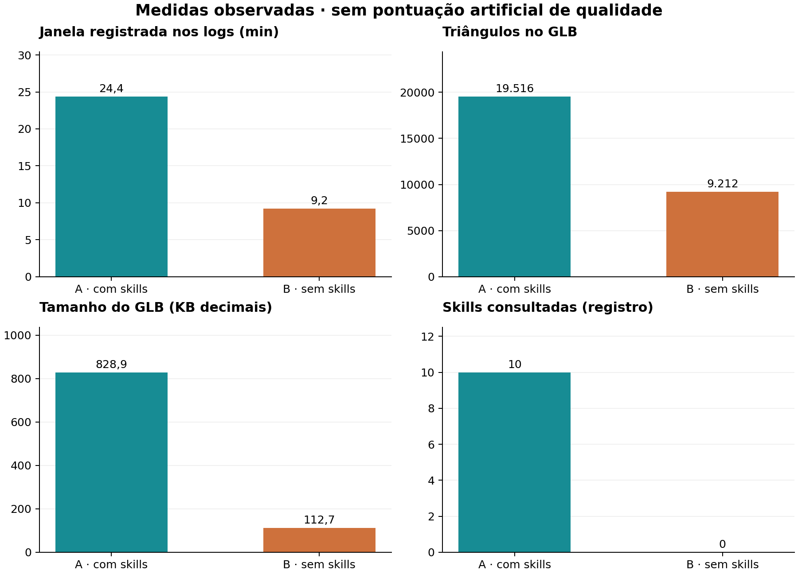
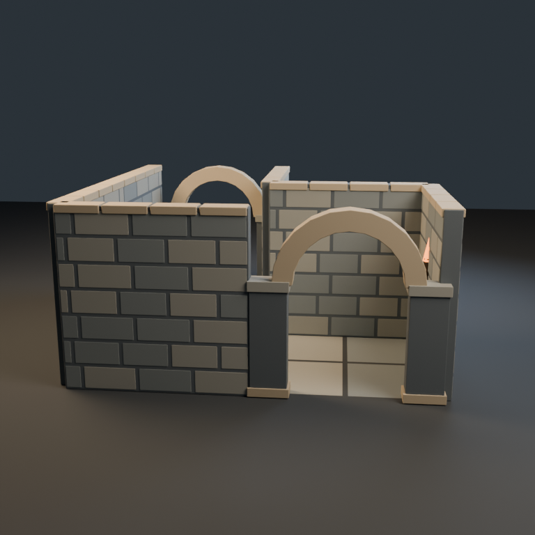
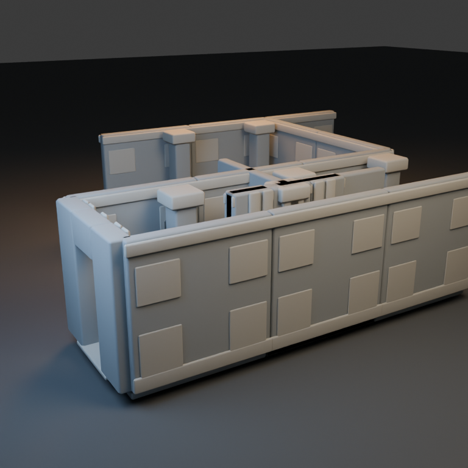
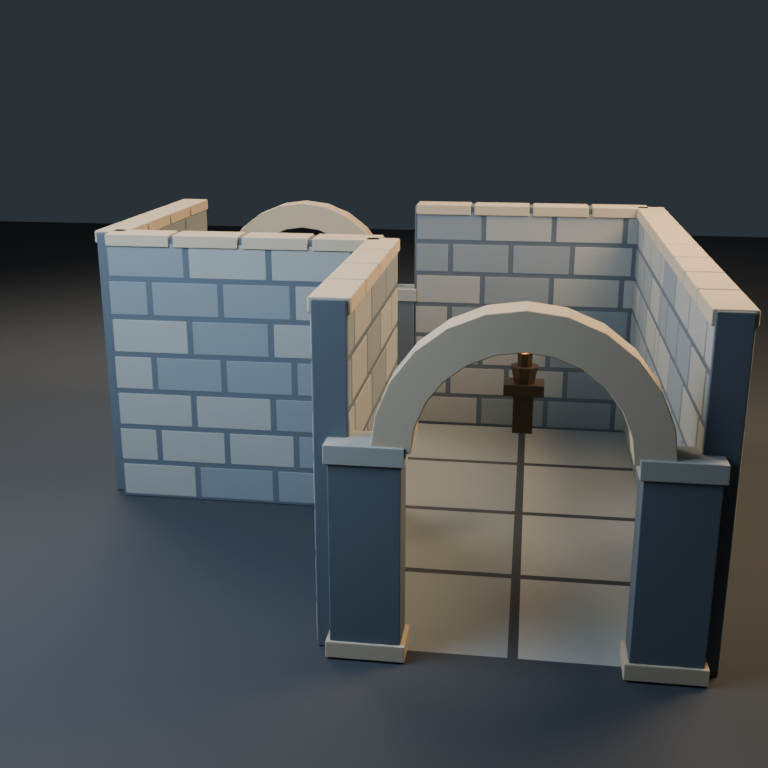
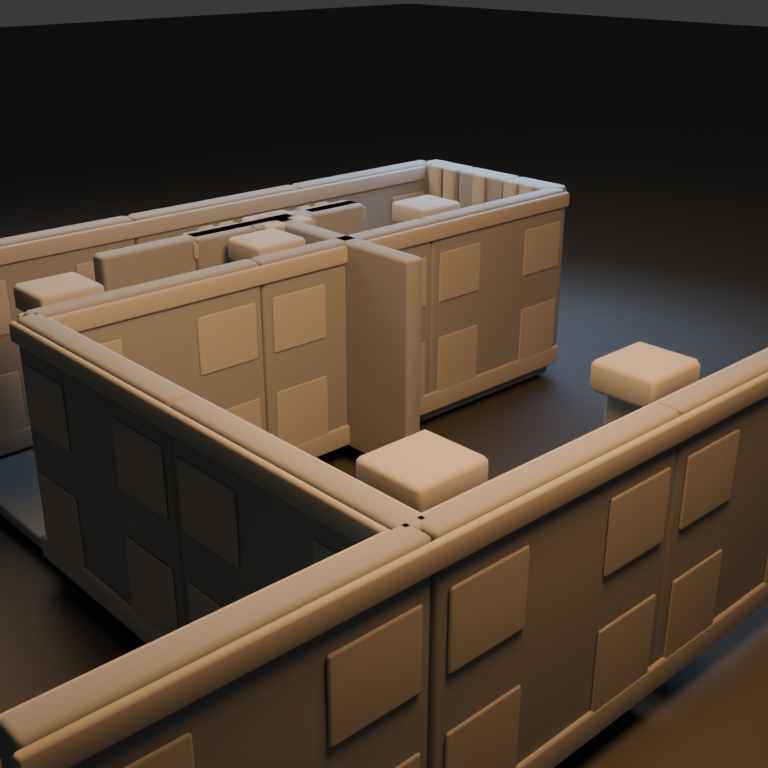
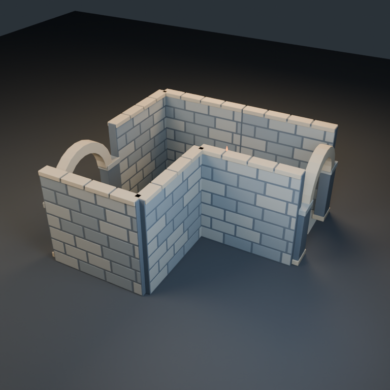
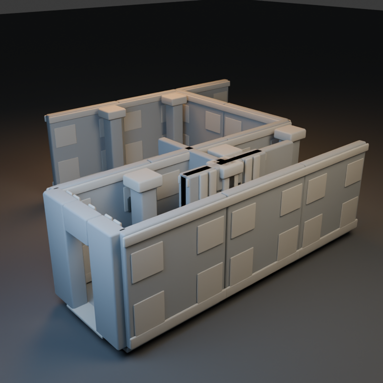

# Kit modular: peças, encaixes e circulação

Prefiro A como base para continuar: arco, paginação de pedra, origens e separação da montagem ficaram mais coerentes. Isso veio com GLB muito maior e 19.516 triângulos efetivamente exportados, contra 9.212 em B. Ambas têm falhas: A mantém juntas coplanares e uma tocha num trecho examinado; B exporta protótipos sobrepostos à montagem e uma parede atravessa a transição da curva.

Módulos individuais válidos não garantem uma montagem utilizável. A qualidade aqui deve separar forma, encaixe, circulação e custo da exportação. O teste de raios encontra contatos em segmentos selecionados, não certifica navegação de um avatar. Nenhuma versão está pronta para uso no Roblox sem correções e validação no Studio.

## Pedido

Crie no Blender um kit modular low poly de corredor de masmorra para uso posterior no Roblox Studio. Inclua piso, parede, canto, arco de porta, coluna e tocha, além de uma montagem demonstrativa com uma curva e uma entrada atravessável. As peças devem se encaixar numa grade de 4 unidades Blender, com origens úteis para montagem, nomes claros e materiais consistentes. Quero corredores e portas com passagem livre, sem peças soltas ou frestas visíveis. Exporte asset.glb com a montagem demonstrativa e também um GLB separado por tipo de módulo na pasta modules/. Documente a escala usada e como repetir os encaixes; não é necessário abrir o Roblox Studio nem escrever scripts de jogo.

Entregue asset.blend, asset.glb, generate.py e README.md, além de três renders PNG de 768×768 (front.png, back.png e presentation.png), com vistas que permitam avaliar a construção. O GLB deve conter somente o asset e seus materiais; mantenha chão de estúdio, luzes e câmeras fora da exportação. Prefira materiais autossuficientes, sem dependências externas. Revise visualmente suas imagens e corrija os problemas que encontrar antes de concluir. Não basta descrever a cena: gere e verifique os arquivos.

## Medidas

| Medida | A · com skills | B · sem skills |
|---|---:|---:|
| Tempo registrado (s) | 1461,0 | 552,0 |
| Skills lidas | 10 | 0 |
| Triângulos exportados | 19516 | 9212 |
| Objetos de malha exportados | 13 | 217 |
| Materiais exportados | 6 | 5 |
| Arquivo .blend (bytes) | 148141 | 138481 |
| Arquivo .glb (bytes) | 828860 | 112708 |
| Polígonos na fonte, antes de modificadores | 2806 | 5418 |
| Triângulos na fonte, antes de modificadores | 5548 | 9212 |
| Triângulos avaliados no .blend | 19516 | 9212 |
| Vértices de posição, por instância | 24254 | 11900 |
| Definições de malha no GLB | 13 | 33 |
| Triângulos nas definições de malha | 19516 | 1368 |
| Clipes de animação no GLB | 0 | 0 |
| Dimensões XYZ (unidades da cena) | 8.500 × 8.460 × 4.380 | 16.370 × 12.550 × 4.320 |
| Tokens reais | não disponíveis | não disponíveis |

## Galeria

### Frente

A usa um arco curvo e alvenaria com paginação mais clara. B usa uma moldura reta e painéis maiores. A entrada de ambas foi examinada geometricamente e os raios de entrada passaram, mas isso não valida a circulação interna.

### Trás

O verso de A permite ver a outra entrada e uma tocha no interior. B evidencia encontros escuros entre tampas e paredes. Não trato automaticamente toda região escura como buraco: parte pode ser sombra, sobreposição ou faces coincidentes. Os dados de geometria e percursos foram verificados separadamente.

### Apresentação

A mostra uma montagem em L mais compacta. B contém componentes-fonte e a demonstração ao mesmo tempo, incluindo peças sobrepostas na origem. A preferência por A não elimina suas pendências: juntas coplanares, contato de uma tocha com um segmento do trajeto e necessidade de conferir colisão/escala no Roblox.

## Resultado A

A entregou seis GLBs de módulo, cada um com um nó/malha na origem. O GLB principal contém somente a montagem e tem 13 malhas, seis materiais e 19.516 triângulos instanciados, medidos após exportação. O arquivo ocupa 828.860 bytes. A paginação da parede, o arco curvo e a coluna têm mais detalhe e consistência que B na minha avaliação.

O agente declarou 5.548 triângulos da montagem. A auditoria encontrou 19.516 no GLB e confirmei o mesmo número diretamente nas primitivas glTF. A contagem menor corresponde à malha-base, antes de todos os efeitos da exportação/modificadores. Não usei esse valor declarado como se fosse o resultado final. Parede e canto isolados chegam a 2.948 e 2.928 triângulos, respectivamente, ainda abaixo dos 3 mil declarados por módulo.

O fluxo de QA identificou UVs ausentes, contatos no arco/tocha e uma parede que bloqueava um vão. O agente adicionou UVs e removeu a parede. Os módulos passaram no perfil Roblox, mas o QA da montagem ainda registra seis pares coplanares em juntas; o README aceita e explica essa limitação. Logo, não há um pass global sem ressalvas.

A documentação usa 1 unidade Blender = 1 metro e explicita a conversão aproximada para studs. A abertura declarada é de 2,24 × 3,57 m. Isso não foi testado no Studio. O teste independente de trajetos também atingiu uma tocha em um dos trechos; a montagem exige revisar seu posicionamento/suporte e não deve ser chamada de circulação integralmente validada.

## Resultado B

B entregou os seis tipos de módulo e GLB principal de 112.708 bytes. O arquivo tem 33 definições de malha reutilizadas em 217 nós de malha, totalizando 9.212 triângulos quando as instâncias são contadas. A geometria única armazenada soma 1.368 triângulos, explicando parte da economia do arquivo. Isso é distinto do total desenhado na cena.

O acabamento é mais simples: moldura reta, parede com painéis largos e coluna quadrangular. A inspeção neutra também mostra um artefato escuro no encontro do canto. As peças carregam e têm materiais, mas a montagem tem problemas mais importantes que apresentação.

O gerador exporta assets.all_objects, incluindo as coleções MODULE e DEMO. Os protótipos ficam sobrepostos em torno da origem; um jamb do arco-fonte atingiu o raio do corredor principal. Na curva, o gerador mantém uma parede ao norte do último segmento reto, na linha y=2, que atravessa o acesso à continuação do piso. O raio (4,0)→(4,4) atingiu essa parede em y=1,8.

A revisão do próprio agente corrigiu offsets que não giravam, câmeras e colunas, mas não identificou esses problemas finais. O README usa 1 unidade Blender = 1 stud e declara passagem de cerca de 1,4 × 3,1 unidades. Essa escala difere da escolhida por A e precisa ser conferida com o avatar-alvo; não afirmo compatibilidade pronta no Roblox.

## Desconstrução da conclusão

A é minha preferência para continuação, principalmente por clareza construtiva e organização, mas usa cerca de 2,12 vezes os triângulos e 7,35 vezes os bytes de B no GLB principal. A maior riqueza geométrica e menor número de objetos não são vantagens gratuitas; desempenho real não foi medido.

B tem um arquivo pequeno graças à reutilização de definições, mas inclui protótipos e uma montagem com problemas de percurso. Economizar bytes não compensa automaticamente deixar de cumprir a organização e a circulação solicitadas. A comparação mistura também interpretações diferentes da extensão da montagem.

As convenções físicas diferem: A trabalha em metros e documenta conversão para studs; B associa diretamente unidades a studs. Ambos usam passo numérico quatro no Blender, mas não resultam na mesma escala física no Roblox. Não comparei seus vãos como se fossem o mesmo tamanho para um avatar.

Também precisei corrigir minha própria interpretação: antecipei que todos os raios de A ficariam livres, mas a leitura completa encontrou a tocha. Um contato pontual de raio não demonstra bloqueio de toda a passagem; a conclusão final preserva esse resultado e não o transforma em teste de navegação.

Nem o QA dos módulos nem as imagens bastam para atestar o conjunto. Os seis pares coplanares em A e os obstáculos de B mostram falhas distintas. A avaliação ainda é não cega, sem repetição, e sofreu retomada do ambiente. Os tempos não medem tokens.

## Verificação e limites

Reabri ambos os .blend e reimportei os dois GLBs principais com o mesmo script. Os totais de triângulos, instâncias, definições e materiais foram confrontados com os dados glTF. Os seis PNGs dos agentes medem 768 × 768.

Reimportei separadamente os doze módulos durante a geração de doze renders neutros de 384 × 384. Os manifests registram dimensões, limites, origens das malhas e contagem por módulo. Os pisos de ambas medem exatamente 4 × 4 unidades; frisos e espessuras fazem alguns outros limites externos exceder quatro, o que não é, sozinho, falha de passo da grade.

O check_routes.py preserva os segmentos exatos e os primeiros contatos com superfícies. A seção de malha em Z=1,5 ajuda a localizar os obstáculos. Não houve busca completa de caminho, teste de suporte do piso, avatar, configuração de colisores ou Studio. Não afirmo que todo raio atingido representa passagem completamente bloqueada.

As imagens neutras e o diagrama são inspeções do avaliador; não são entregas dos agentes nem alterações dos assets. A primeira contagem de 5.548 citada pelo agente A e os logs originais foram preservados, ao lado da contagem final de 19.516 confirmada por dois métodos.

## Próximos passos

Em A, corrigir as seis juntas coplanares, recolocar a tocha num suporte coerente e avaliar se é possível preservar o visual com menos bevel/geometria e mais reutilização de dados.

Em B, exportar somente a montagem em asset.glb, manter os protótipos fora dela e remover/reorganizar a parede na transição da curva. Rever também o encontro escuro do canto.

Fixar a mesma convenção de unidades para o projeto e testar altura/largura de passagem com o avatar-alvo no Roblox Studio.

Aplicar orçamento de polígonos sobre o GLB final, contando as instâncias, e não apenas sobre a malha-base. Validar também montagem e circulação, não só peças isoladas.

## Skills consultadas

- **[blender-asset-qa](https://github.com/EL4CTEO/blender-skills/blob/fb92cfb4cc5a238c22113a6a230b09f535bd0656/skills/blender-asset-qa/SKILL.md)**: QA separada dos módulos e da montagem; seis pares coplanares ainda registrados na montagem.

- **[blender-core](https://github.com/EL4CTEO/blender-skills/blob/fb92cfb4cc5a238c22113a6a230b09f535bd0656/skills/blender-core/SKILL.md)**: Execução dentro do Blender; corrigiu chamada inicial via Python externo.

- **[blender-environment-kits](https://github.com/EL4CTEO/blender-skills/blob/fb92cfb4cc5a238c22113a6a230b09f535bd0656/skills/blender-environment-kits/SKILL.md)**: Encaixes e organização modular.

- **[blender-export-pipelines](https://github.com/EL4CTEO/blender-skills/blob/fb92cfb4cc5a238c22113a6a230b09f535bd0656/skills/blender-export-pipelines/SKILL.md)**: Exportação de módulos e referência roblox.md; um nó por módulo em A.

- **[blender-hardsurface-modeling](https://github.com/EL4CTEO/blender-skills/blob/fb92cfb4cc5a238c22113a6a230b09f535bd0656/skills/blender-hardsurface-modeling/SKILL.md)**: Construção dos módulos e detalhes de pedra.

- **[blender-lighting-lookdev](https://github.com/EL4CTEO/blender-skills/blob/fb92cfb4cc5a238c22113a6a230b09f535bd0656/skills/blender-lighting-lookdev/SKILL.md)**: Câmeras e apresentação.

- **[blender-pbr-materials](https://github.com/EL4CTEO/blender-skills/blob/fb92cfb4cc5a238c22113a6a230b09f535bd0656/skills/blender-pbr-materials/SKILL.md)**: Materiais de pedra, metal e chama.

- **[blender-rendering](https://github.com/EL4CTEO/blender-skills/blob/fb92cfb4cc5a238c22113a6a230b09f535bd0656/skills/blender-rendering/SKILL.md)**: Três vistas da montagem.

- **[blender-retopology-uv](https://github.com/EL4CTEO/blender-skills/blob/fb92cfb4cc5a238c22113a6a230b09f535bd0656/skills/blender-retopology-uv/SKILL.md)**: Adição de UVs e validação 0–1 após falhas iniciais.

- **[blender-scene-setup](https://github.com/EL4CTEO/blender-skills/blob/fb92cfb4cc5a238c22113a6a230b09f535bd0656/skills/blender-scene-setup/SKILL.md)**: Unidades, origens e coleções.

Nenhuma skill foi modificada. Tokens reais indisponíveis. Modelo gpt-6-luna medium, Blender 5.2.3, uma execução por condição; avaliação não cega. Veja o PDF e o manifesto para detalhes.